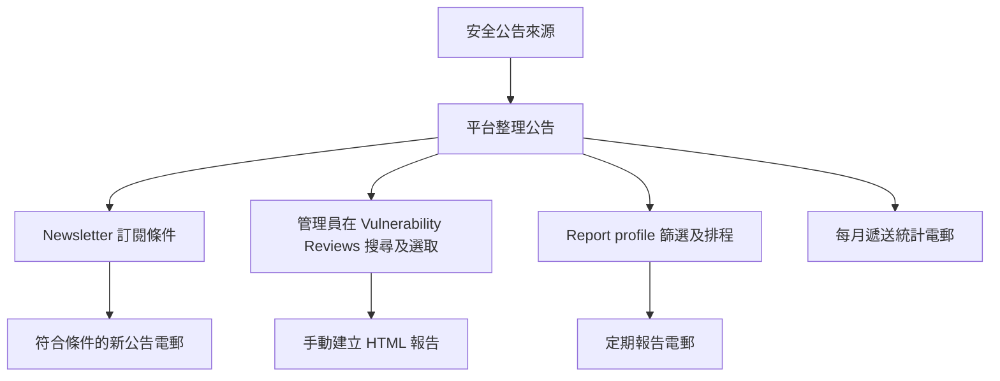
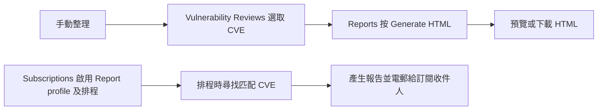

# 安全新聞管理平台系統指南

本指南介紹平台的主要功能，並逐步說明一般使用者和管理員如何操作。系統畫面目前為英文；本文保留按鈕及欄位的英文名稱，方便在畫面中尋找。

**系統網址：** <http://100.114.50.103:9100/login>  
**適用對象：** Zimbra 使用者及本機管理員

> 需登入後才能查看訂閱及管理資料，因此本文不包含私人畫面的實際截圖。以下流程圖是操作示意；每月統計在系統中以電郵表格呈現，並非圖表。

## 系統功能總覽

平台主要用來接收、篩選和寄送安全公告，亦可整理漏洞資料並產生報告。

| 功能 | 說明 | 使用者 |
|---|---|---|
| **Subscriptions** | 設定收件人、Newsletter 新公告通知、報告條件及排程 | 所有已登入使用者；管理員可管理全部訂閱 |
| **Vulnerability Reviews** | 依產品清單和嚴重程度搜尋公告、預覽電郵、選取漏洞 | 本機管理員 |
| **Reports** | 由已選漏洞或匯出資料建立 HTML 報告，檢視工作及翻譯結果 | 本機管理員 |
| **Operations** | 查看排程及電郵狀態、調整 Newsletter 範本、查看來源網址 | 本機管理員 |
| **Settings** | 查看帳戶資料；本機帳戶可更改電郵和密碼 | 所有已登入使用者 |

### 兩種主要訂閱

- **Newsletter feed**：有符合條件的新公告時寄送，不會因首次啟用或修改條件而補寄舊公告。
- **Report profile**：依嚴重程度、產品和時間範圍尋找 CVE，可按設定排程產生報告。
- 兩者可以同時啟用，也可以只開啟其中一種。新帳戶的兩種設定預設均關閉。



## 登入與權限

### Zimbra 使用者

1. 開啟系統網址。
2. 在 **Zimbra email address** 輸入完整電郵地址，在 **Password** 輸入 Zimbra 密碼。
3. 按 **Sign In**。如畫面要求雙重驗證，輸入驗證器 App 顯示的六位數代碼。

首次登入後，系統會建立你的個人訂閱，並確認 Zimbra 郵箱內有 `news` 資料夾；如沒有便會建立。訂閱建立後仍是關閉狀態，需要自行設定和啟用。

Zimbra 使用者可使用 **Subscriptions** 和 **Settings**，並只可查看及管理自己的訂閱。自動建立的個人訂閱不能刪除；自行新增的訂閱可以刪除。

### 本機管理員

在登入頁按 **Use local admin sign-in**，或開啟 `/login/local`，輸入由系統負責人提供的本機管理員帳戶資料。管理員可以管理所有訂閱，並使用 **Vulnerability Reviews**、**Reports** 和 **Operations**。

目前可用的管理權限以本機管理員為主。若一般使用者看不到管理員功能，請聯絡系統管理員確認帳戶權限。

## 設定訂閱

在 **Subscriptions** 頁面按 **Add Subscription** 新增訂閱，或選取現有訂閱編輯。清單會顯示訂閱者、Newsletter 狀態、Report 狀態及可用操作。

### 收件人設定

- **To**：主要收件人。
- **CC**：副本收件人，其他收件人可看到其電郵地址。
- **BCC**：密件副本收件人，地址不會顯示在電郵標頭。
- To、CC、BCC 合計最多 50 個不重複的有效電郵地址。
- 每個 To 地址會各自收到一封電郵；CC 和 BCC 收件人會收到副本。
- 副本收件人適用於訂閱通知、Newsletter、排程報告及每月統計。

新增、更新或取消訂閱後，系統會寄出相應通知。儲存前請檢查地址拼寫；無效地址會令儲存失敗。

### 設定 Newsletter feed

Newsletter feed 會將符合篩選條件的新公告寄到 To、CC 和 BCC 收件人。

1. 開啟 **Newsletter feed enabled**。
2. 在 **Sources** 選擇至少一個來源。可用來源清單由管理員維護。
3. 選擇需要的嚴重程度：**Critical**、**High**、**Medium**、**Low**。全部不選代表包括所有已知嚴重程度。
4. 如需包括沒有嚴重程度資料的公告，勾選 **Include unknown severity**。
5. 如需只接收與公司產品有關的公告，匯入產品清單 CSV。
6. 檢查清單及收件人，按 **Save** 儲存。

產品清單 CSV 必須使用以下四個欄位名稱：

```csv
vendor,product,vendor_aliases,product_aliases
Red Hat,Enterprise Linux,"Red Hat, Inc.|RedHat",RHEL|Red Hat Enterprise Linux
Microsoft,Windows Server,Microsoft Corporation,Windows Server 2019|Windows Server 2022
```

`vendor` 和 `product` 必填；別名可留空，多個別名以 `|` 分隔。不要刪除標題列或更改欄位名稱。可按 **Download CSV template** 下載範本。每份 CSV 最多 500 筆資料，大小上限為 1 MiB。匯入後先檢查預覽，再儲存。

例子：若只想追蹤 Microsoft Windows Server 的高危公告，可加入 Microsoft 和 Windows Server 產品列，選擇 **Critical** 及 **High**，並確認產品別名涵蓋公司實際使用的名稱。

**Include product-only possible matches when structured vendor data is missing** 會納入只有產品名稱、缺少完整廠商資料的可能匹配。這有助找出更多公告，但也可能誤配；若勾選，建議檢查結果。

已儲存的訂閱可按 **Download saved CSV** 下載目前產品清單。此下載不包含尚未按 **Save** 儲存的修改；**Download CSV template** 則是格式範本。

#### Newsletter 儲存前檢查

1. To 至少有一個收件人。
2. 已選擇需要的來源。
3. 嚴重程度及未知嚴重程度設定符合預期。
4. 如有產品清單，預覽中的廠商、產品和別名正確。
5. **Newsletter feed enabled** 已開啟，再按 **Save**。

**新公告規則：** 首次啟用 Newsletter 或更改來源、嚴重程度、產品篩選條件後，系統從當時開始追蹤，只寄送之後符合條件的新公告，不會補寄舊公告。

### 設定 Report profile

Report profile 用來篩選 CVE 記錄及設定報告排程。預覽會顯示匹配數量和部分 CVE 範例。

1. 開啟 **Report profile enabled**。
2. 選擇嚴重程度；如需產品篩選，匯入產品清單。
3. 在 **Time window** 選擇 **All time**、**Today**、**Last 7 days** 或 **Custom**。選 **Custom** 時須填寫 **Start** 和 **End**。
4. 查看 **Report Preview** 的匹配數量及 CVE 範例。若數量為零，先檢查時間範圍、產品名稱和嚴重程度條件。
5. 選擇報告模式。
6. 如需自動寄送，開啟 **Report schedule enabled** 並設定排程。
7. 確認收件人及設定後按 **Save**。

| 報告模式 | 適合用途 | 注意事項 |
|---|---|---|
| **Fixed Template** | 使用固定格式整理已選資料，亦可處理平台匯出的 JSON | 內容取決於來源公告資料是否完整 |
| **Enriched Weekly** | 為已選 CVE 補充廠商公告、影響和修補建議 | 只處理已選 CVE，不會自行發現新 CVE；需要外部搜尋及報告服務，處理時間可能較長 |

啟用產品清單後，預覽可能列出 confirmed、probable、possible 等匹配信心分類。這些分類是檢查線索，不保證每個可能匹配都確實受影響；請檢視範例後再儲存。

#### 報告排程（香港時間）

排程使用香港時間（HKT）及五欄 cron 格式，依次代表「分鐘、小時、每月日期、月份、星期」。預設 `0 9 * * 1` 代表每星期一上午 9 時。

| 排程設定 | 執行時間（HKT） |
|---|---|
| `0 9 * * 1` | 每星期一上午 9 時 |
| `0 9 * * *` | 每日早上 9 時 |
| `30 18 * * *` | 每日下午 6 時 30 分 |
| `0 9 * * 1-5` | 星期一至星期五上午 9 時 |

星期欄位以 `0` 代表星期日、`1` 代表星期一，依此類推至 `6`（星期六）。報告設定及排程開關必須同時開啟，全系統排程亦須正常運作，系統才會自動產生和寄出報告。

### 每月新聞遞送統計

在 Newsletter 設定下方開啟 **Monthly statistic email schedule enabled**，系統便會在每月 1 日上午 9 時（HKT）寄出上個完整曆月的遞送統計。統計按來源列出成功寄送數量和比例；已選來源即使沒有遞送記錄，也會以零顯示。

- **Preview monthly statistics**：預覽統計電郵。
- **Send monthly statistics**：立即寄出目前已儲存設定的統計。
- 每月自動寄送要求 Newsletter feed 已啟用，且全系統排程正常。
- 統計涵蓋上個曆月，不是最近 30 日。沒有成功寄送時，數字可能全為零。

### 管理或刪除訂閱

自動建立的 Zimbra 個人訂閱不可刪除，但可編輯。使用者可以新增及刪除自己建立的其他訂閱；本機管理員可以管理所有訂閱。Newsletter 和 Report profile 在同一訂閱中各自獨立，可只啟用其中一項。

## 漏洞審閱（管理員）

在 **Vulnerability Reviews** 可搜尋安全公告、預覽 Newsletter 電郵、選取記錄並建立報告。

### 搜尋公告

1. 在 **Vendor/product CSV filter** 載入產品清單。這個頁面的搜尋必須先載入有效 CSV。
2. 使用 **Download CSV template** 取得範本，填入廠商和產品後上傳。
3. 選擇 **Severity**，並決定是否勾選 **Include unknown severity**。
4. 在 **Time window** 選擇全部時間、今天、最近七天或自訂日期範圍。
5. 如要納入缺少結構化廠商資料的可能匹配，勾選 **Include product-only possible matches when structured vendor data is missing**。
6. 按 **Apply Filter** 查看結果。

結果表格可調整每頁筆數，並使用 **Previous** 和 **Next** 翻頁。太多或沒有結果時，調整產品清單、嚴重程度或時間範圍後再搜尋。

### 預覽及選取記錄

- 按記錄旁的 **View** 查看排版後的 Newsletter 電郵預覽。
- 勾選個別記錄加入選取清單；頁面頂部的數字會顯示已選數量。
- **Auto-select top** 可設定 1 至 500 筆，再按 **By importance** 自動選取目前篩選條件下較重要的記錄。此操作會取代目前的選取項目。
- **Clear Selection** 會清空選取清單；**Clear** 會重設搜尋篩選條件。
- 有選取記錄後，按 **Export JSON** 匯出，或按 **Generate HTML** 前往報告頁面。

## 建立、檢視及翻譯報告（管理員）

### 手動建立報告

1. 先在 **Vulnerability Reviews** 選取記錄，再按 **Generate HTML**；也可開啟 **Reports** 頁直接查看已有選取項目。
2. 在 **Generation Mode** 選 **Fixed Template** 或 **Enriched Weekly**。
3. 通常使用目前選取的 CVE。使用檔案時，選 **Fixed Template**，上傳從平台按 **Export JSON** 匯出的 JSON 陣列。
4. Enriched Weekly 可填寫 **Enrichment search hint**，為已選 CVE 指定搜尋重點。提示最多 200 個字元，且不會自動尋找其他 CVE。
5. 確認選取數量後按 **Generate HTML**。

每份工作最多 500 筆記錄。JSON 檔案須為陣列，每筆記錄包含 `details` 物件，檔案大小上限為 20 MiB。Enriched Weekly 不接受 JSON 上傳，只使用已選取的 CVE 記錄。

**Reports** 頁建立的手動報告會產生 HTML，可在網站預覽或下載；這項操作本身不會寄送給訂閱收件人。若要定期產生並電郵報告，請在 Subscriptions 啟用 Report profile 排程。

### 查看報告歷史

**Report History** 會列出建立時間、語言、來源、產生模式、狀態及可用操作。常見狀態：

| 狀態 | 意義 |
|---|---|
| **Queued** | 等候處理 |
| **Running** | 正在處理；頁面會顯示進度 |
| **Completed** | 已完成，可預覽或下載 HTML |
| **Failed** | 執行失敗；可按 **View log** 查看錯誤摘要 |
| **Cancelled** | 已取消 |

排隊或執行中的工作可取消；已結束的工作可刪除。Enriched Weekly 可能較慢，因為系統會逐筆處理 CVE 並查找外部資料。失敗時查看 **View log**，再聯絡管理員。

### 翻譯報告

已完成的 Reports 頁報告以英文產生。可從歷史記錄選擇翻譯成繁體中文或簡體中文。翻譯會新增另一筆歷史記錄，不會取代原報告，也不會自動寄出電郵。排程報告目前亦以英文寄送；如需中文版，請管理員在報告完成後另行翻譯。

選擇 **Enriched Weekly** 時，管理員可能會看到 **Purge Search Cache** 和 **Purge Evidence Cache**。這些操作會清除已儲存的搜尋或證據結果；下次執行會重新查找資料，可能增加等待時間或外部服務用量。一般不需清除，請只在確定需要時使用。



## 管理員系統功能

### Operations：排程及電郵狀態

**Scheduler Health** 可查看最近排程回報、預定報告、Newsletter 狀態、最近一次電郵及錯誤。如果最近回報超過兩分鐘沒有更新，排程可能未正常運作，請由管理員檢查。

Newsletter 區域會顯示遞送游標、已寄送數量、最近一次電郵及錯誤；Scheduled reports 區域會顯示排程、下一次執行時間、最近執行和錯誤。一般使用者沒有此頁面權限，可請管理員協助確認。

### Email Templates：調整 Newsletter 電郵

1. 開啟 **Email Templates** 分頁。
2. 選擇要編輯的來源。
3. 設定共用 **Subject line**、**Extra content** 和 **Footer**。
4. 在 **Available fields** 加入需要顯示的欄位，在 **Email order** 調整次序。
5. 預覽確認後按 **Save template**。

主旨可使用 `{{title}}` 插入公告標題，或使用 `{{collection}}` 插入來源名稱。儲存後產生的 Newsletter 會採用新範本。

### Source List：檢視來源網址

在 **Source List** 分頁檢視目前公告資料中的來源網址。來源清單若空白或載入失敗，請管理員檢查來源資料是否已更新。

## Settings 帳戶設定

按上方 **Settings** 查看帳戶資料。

- Zimbra 使用者的密碼和存取權限由 Zimbra 管理，請透過 Zimbra 更新。
- 本機帳戶可使用 **Save profile** 更新電郵地址，並使用 **Change password** 更新密碼。
- 若你沒有管理員權限或無法修改帳戶資料，請聯絡系統管理員。

## 常見問題

| 情況 | 建議處理方法 |
|---|---|
| 無法登入 | 確認使用完整 Zimbra 電郵地址及正確密碼；如有雙重驗證要求，輸入最新六位數代碼。 |
| 登入後看不到個人訂閱 | 重新載入 **Subscriptions**。首次 Zimbra 登入會建立個人訂閱；若仍沒有資料，請聯絡管理員。 |
| 看不到 Reviews、Reports 或 Operations | 這些功能只向本機管理員開放。請聯絡管理員確認權限。 |
| Review 搜尋不能開始 | 先按 **Download CSV template**，填好 `vendor` 和 `product` 欄位後重新上傳。 |
| CSV 匯入失敗 | 標題列須為 `vendor,product,vendor_aliases,product_aliases`；`vendor` 和 `product` 不可留空，別名以 `|` 分隔。 |
| Newsletter 已啟用但沒有新電郵 | 確認收件人、來源、嚴重程度和產品篩選條件。更改篩選後不會補寄舊公告；再請管理員檢查 Operations 狀態。 |
| Report Preview 為零 | 檢查時間範圍、產品拼寫、嚴重程度及未知嚴重程度設定。 |
| 報告沒有自動寄出 | 確認 **Report profile enabled** 和 **Report schedule enabled** 都已開啟，排程使用 HKT，並檢查 Operations 狀態。 |
| Enriched Weekly 失敗 | 可改用 **Fixed Template**；若需要 Enriched Weekly，請管理員檢查搜尋及報告服務。 |
| 每月統計沒有寄出 | 確認 Newsletter feed 和每月統計排程都已開啟，再請管理員檢查 Operations。 |

## 操作限制速查

| 項目 | 上限或規則 |
|---|---|
| To、CC、BCC 收件人 | 合計最多 50 個不重複地址 |
| 訂閱產品清單 CSV | 500 筆資料、1 MiB |
| Review 自動選取及報告工作 | 最多 500 筆記錄 |
| Reports JSON 上傳 | 20 MiB；JSON 陣列，每筆需有 `details` 物件 |
| Newsletter 歷史公告 | 啟用或更改篩選後不補寄舊資料 |
| 每月統計 | 上個完整曆月；每月 1 日 09:00 HKT 排程 |

## 名詞簡介

- **Source（來源）**：提供安全公告的機構或資料來源。
- **Newsletter feed**：符合訂閱條件的新安全公告電郵。
- **Report profile**：用來篩選 CVE 及設定定期報告的訂閱設定。
- **Fixed Template**：使用固定版面產生報告。
- **Enriched Weekly**：為已選 CVE 搜尋外部資料，再產生較完整的報告。
- **HKT**：香港時間（UTC+8）。
