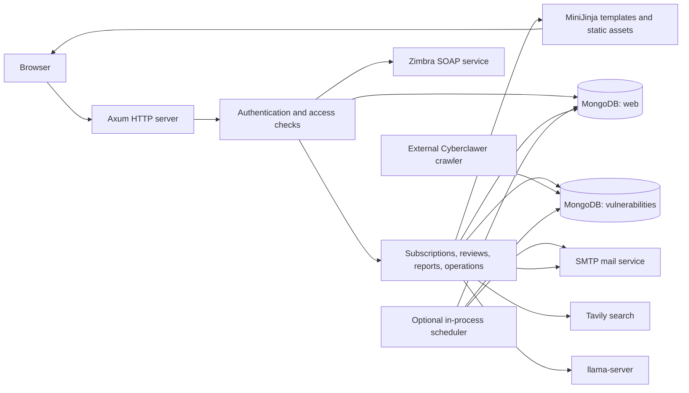
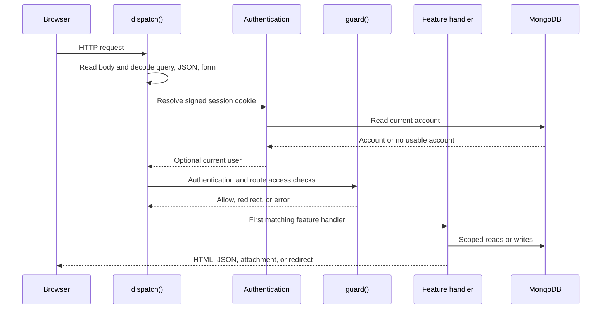
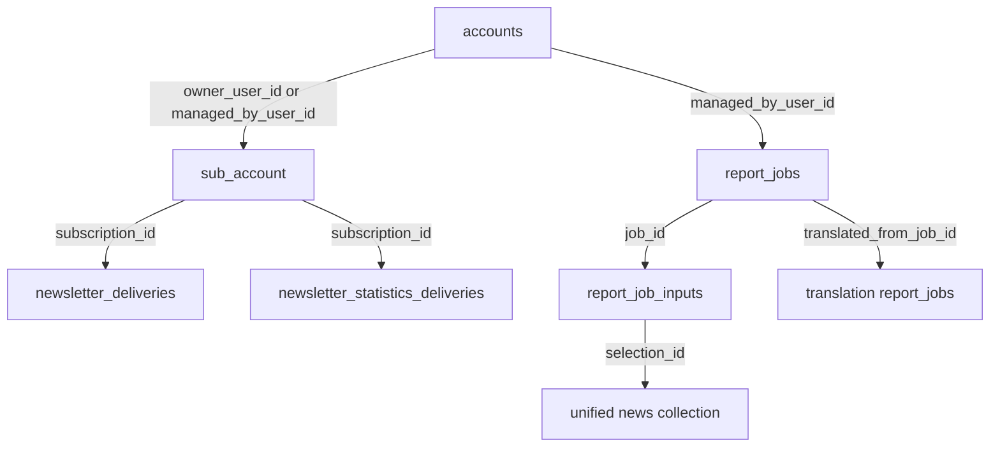
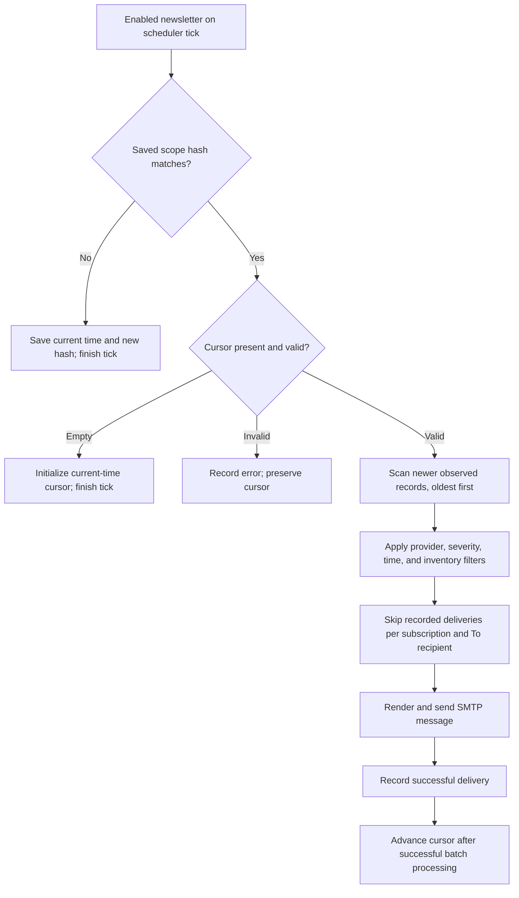
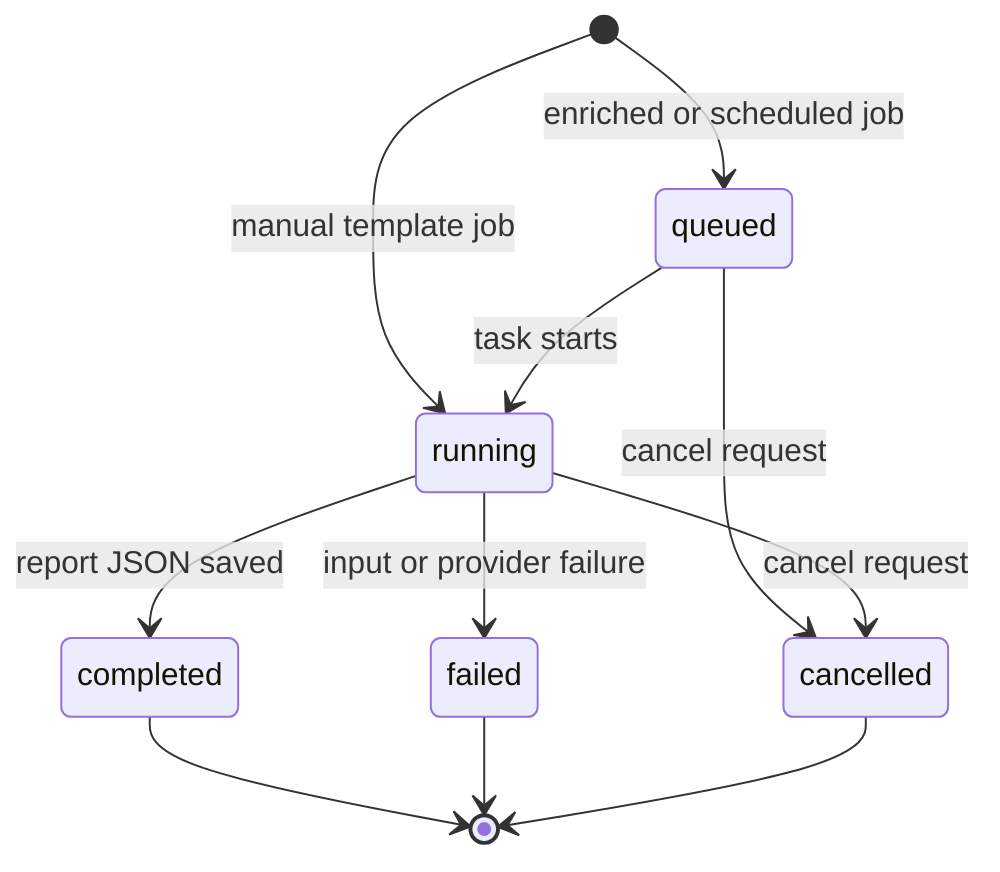

# Security Newsletter Portal — System and Developer Documentation

Reviewed against the repository-root implementation on **6 November 2026**, branch `redesign/unified-news-collection`, source commit `6aae75b`.

This guide introduces the system, explains how its parts work together, and provides the information needed to develop, operate, and extend it. It describes the implementation in the root `src/`, `templates/`, and `static/` directories. Separate checkouts under `worktrees/` are outside this document's scope. Where configuration names or older assets suggest features that are no longer active, the distinction is stated explicitly.

## Contents

1. [System purpose and boundaries](#1-system-purpose-and-boundaries)
2. [Architecture and technology](#2-architecture-and-technology)
3. [Repository and module map](#3-repository-and-module-map)
4. [Startup and request processing](#4-startup-and-request-processing)
5. [Accounts, authentication, and authorization](#5-accounts-authentication-and-authorization)
6. [MongoDB data model](#6-mongodb-data-model)
7. [Subscription model and lifecycle](#7-subscription-model-and-lifecycle)
8. [Filtering, inventory matching, and review selection](#8-filtering-inventory-matching-and-review-selection)
9. [Newsletter normalization and templates](#9-newsletter-normalization-and-templates)
10. [SMTP delivery and newsletter scheduling](#10-smtp-delivery-and-newsletter-scheduling)
11. [Reports and translation](#11-reports-and-translation)
12. [Monthly delivery statistics](#12-monthly-delivery-statistics)
13. [HTTP endpoint reference](#13-http-endpoint-reference)
14. [Configuration reference](#14-configuration-reference)
15. [Local development and verification](#15-local-development-and-verification)
16. [Deployment, migration, and recovery](#16-deployment-migration-and-recovery)
17. [Operations and troubleshooting](#17-operations-and-troubleshooting)
18. [Extension guide and implementation constraints](#18-extension-guide-and-implementation-constraints)

## 1. System purpose and boundaries

The portal turns collected vulnerability and security-advisory records into filtered email feeds and HTML reports. Users maintain recipient lists and product inventories; administrators review records, generate reports, inspect delivery status, and configure newsletter presentation.

There are three distinct delivery products:

| Product | Input and trigger | Output |
| --- | --- | --- |
| Newsletter feed | Newly observed records matching an enabled subscription | One source-formatted advisory email per matching record and To recipient |
| Scheduled report | Records matching an enabled report profile when its cron schedule becomes due | A report job and, after completion, a summary email |
| Monthly newsletter statistics | Successful newsletter-delivery history for the preceding HKT calendar month | A personalized count and source-share email per To recipient |

Administrators can also generate and translate reports manually. Creating a report through the Reports page does not send it to subscribers.

### 1.1 What is implemented here

- A Rust HTTP server with server-rendered pages and JSON endpoints.
- Zimbra authentication, including a six-digit authenticator challenge when required by Zimbra.
- One configured local administrator for recovery and administration.
- Owner-scoped subscriptions with independent newsletter and report profiles.
- CSV product inventories, deterministic vendor/product matching, and advisory review.
- Provider-specific newsletter normalization and email previews.
- Fixed-template reports and search-assisted enriched reports.
- In-process scheduling, SMTP delivery, delivery history, and monthly statistics.
- An interactive Linux installer supporting systemd, Docker Compose, or configuration-only setup.

### 1.2 External systems

| Dependency | Responsibility | Required for |
| --- | --- | --- |
| MongoDB | Accounts, subscription state, jobs, delivery history, and collected news | Server startup and normal operation |
| Cyberclawer / `vuln-scrape` | Scraping, publishing the source catalog, and migrating old news collections | Populating and maintaining the news dataset |
| Zimbra | Verifying mailbox credentials, performing optional 2FA, and ensuring a mailbox folder | Normal end-user sign-in |
| SMTP server | Delivering all application email | Subscription notifications and scheduled/manual email |
| Tavily | Searching for evidence about selected CVEs | Enriched report generation |
| A compatible `llama-server` endpoint | Producing JSON vulnerability cards and translating report JSON | Enriched reports and report translation |
| jsDelivr | Bootstrap CSS, Bootstrap JavaScript, and Bootstrap Icons used by the portal layout | Complete browser styling and modal behavior |

The scraper is a separate application. This repository does not contain its scraping implementation or install MongoDB. The crawler commands mentioned here must be run in the crawler's environment.

### 1.3 Current and legacy concepts

- **Account store:** `web.accounts` by default. Legacy `web.auth` and `web.subscriptions` are not read or migrated by this server.
- **Subscription store:** `web.sub_account`. A subscription record is separate from a login account.
- **News store:** one physical collection, `vulnerabilities.news` by default. Provider identity comes from `source.provider`.
- **Old review names:** selected names such as `cve_review` remain accepted for link compatibility; they resolve to the unified collection.
- **AccountHub:** older templates, JavaScript, tests, and [APIs.md](../APIs.md) remain in the tree. AccountHub authentication and organization administration are not active in this implementation.
- **Roles:** there is no active sub-administrator or organization-administrator tier. `is_admin()` delegates to `is_top_admin()`; `is_organization_admin()` always returns `false`.
- **Delivery transport:** every active mail path uses SMTP. Zimbra folder provisioning does not itself deliver messages into that folder. The SMTP comment in `.env.example` reflects an older design; `src/mail.rs` defines current behavior.

## 2. Architecture and technology

The server is a modular monolith: one executable owns HTTP handling, page rendering, background report tasks, and optional scheduling. MongoDB is the shared persistence layer. There is no separate queue service or frontend build application.



### 2.1 Main technologies

The package is `webserver-rust`, version `0.1.0`, using Rust edition 2024. The Docker builder and installer target Rust 1.91; exact dependency resolution is recorded in [Cargo.lock](../Cargo.lock).

| Area | Library or approach |
| --- | --- |
| HTTP and async execution | Axum 0.8, Tokio, `tower-http` static file serving |
| Persistence | MongoDB Rust driver 3.9, BSON documents |
| Templates | MiniJinja 2.24 with a filesystem loader and compatibility helpers |
| Data formats | Serde, `serde_json`, `serde_urlencoded`, `csv`, `multer` |
| External HTTP | Reqwest with rustls |
| Mail | Lettre with Tokio/rustls SMTP support |
| Local password verification | bcrypt |
| Session signing | HMAC-SHA256 and URL-safe Base64 |
| Zimbra secret encryption | AES-256-GCM, random 12-byte nonce, standard Base64 |
| Time calculations | Chrono; scheduling uses a fixed UTC+8 offset |
| Logging | `tracing` and `tracing-subscriber` |
| Browser code | Plain JavaScript, Bootstrap 5.3.3, Bootstrap Icons 1.11.3 |

### 2.2 Shared application state

`AppState` in [src/main.rs](../src/main.rs) is cloned into handlers and tasks. It contains:

- `cfg`: loaded configuration and the original JSON configuration object.
- `web`: handle to the application database.
- `vuln`: handle to the vulnerability database.
- `templates`: shared MiniJinja environment.
- `http`: reusable Reqwest client for report search and LLM requests.

Zimbra builds a separate HTTP client using its configured timeout and TLS-verification setting.

## 3. Repository and module map

### 3.1 Backend

| File | Main responsibility |
| --- | --- |
| [src/main.rs](../src/main.rs) | Startup, `AppState`, request context, central access guard, handler dispatch, and static serving |
| [src/config.rs](../src/config.rs) | `.env` and JSON loading, environment overrides, defaults, runtime paths |
| [src/db.rs](../src/db.rs) | BSON/JSON conversion, collection/query helpers, identifier handling |
| [src/auth.rs](../src/auth.rs) | Bootstrap administrator, session cookies, local/Zimbra login, 2FA challenges, settings endpoints |
| [src/zimbra.rs](../src/zimbra.rs) | Credential encryption and Zimbra SOAP authentication/folder operations |
| [src/subscriptions.rs](../src/subscriptions.rs) | Subscription ownership, provisioning, CRUD, profile validation, CSV import/export, profile matching, notifications |
| [src/vendor_matcher.rs](../src/vendor_matcher.rs) | Inventory validation, vendor/product normalization, and match confidence/evidence |
| [src/reviews.rs](../src/reviews.rs) | Review filtering, display normalization, scoring, auto-selection, and JSON export |
| [src/newsletters.rs](../src/newsletters.rs) | Template configuration, rendered previews, and legacy static newsletter publication |
| [src/newsletter_normalizer.rs](../src/newsletter_normalizer.rs) | Provider payloads to a common newsletter view model; template selection |
| [src/newsletter_normalizer/splunk.rs](../src/newsletter_normalizer/splunk.rs) | Splunk descriptions, structured tables, and source-order preservation |
| [src/reports.rs](../src/reports.rs) | Job lifecycle, fixed/enriched generation, uploads, translation, HTML rendering, history, cancellation, deletion |
| [src/scheduler.rs](../src/scheduler.rs) | Thirty-second polling loop, newsletter cursors, scheduled reports, delivery recording, heartbeat |
| [src/cron_schedule.rs](../src/cron_schedule.rs) | Five-field cron parsing and next-run calculations in HKT |
| [src/newsletter_statistics.rs](../src/newsletter_statistics.rs) | Monthly aggregation, personalized HTML, claims, delivery logs, and retry state |
| [src/mail.rs](../src/mail.rs) | SMTP transport construction, HTML MIME messages, individual To delivery with CC/BCC |
| [src/view.rs](../src/view.rs) | MiniJinja environment, translation/URL helpers, response helpers, cookie parsing |

### 3.2 Pages and browser assets

| Location | Purpose |
| --- | --- |
| [templates/layouts/base.html](../templates/layouts/base.html) | Shared navigation, page layout, CDN dependencies, current-user context |
| `templates/auth/` | Login, settings, and retained legacy administration templates |
| `templates/subscriptions/` | Subscription editor and notification/statistics email templates |
| `templates/reviews/` | Unified review page and collection browser |
| `templates/reports/` | Report history/editor and the two report output formats |
| `templates/operations/` | Scheduler health, source list, and email-template editor |
| `templates/newsletters/` | Generated/provider-specific email templates and three legacy public HTML files |
| `templates/errors/` | Forbidden and not-found pages |
| `static/js/` | Page controllers, shared source picker, translation helper, and email preview helper |
| `static/css/`, `static/images/` | Stylesheets and the not-found image |

The template environment exposes `t()`, `url_for()`, and `nl2br`. `url_for()` is a manually maintained mapping of endpoint names to URLs; it is not generated from Axum route definitions. Translation strings are included in the compiled executable from [config/translations.json](../config/translations.json).

The portal page locale is currently forced to English in `page_context()`. Existing Chinese translation catalogs remain useful to templates and tests, and report translation has its own language handling.

Review selections are stored in browser `localStorage` under `vulnerabilityReviewSelections`, and the selected report mode under `vulnerabilityReportGenerationMode`. Selection state is browser-local rather than an account database record. Report history polls approximately every two seconds while jobs are active; Operations refreshes health every twenty seconds.

### 3.3 Build, configuration, and deployment files

- [Cargo.toml](../Cargo.toml), [Cargo.lock](../Cargo.lock): package and dependency definitions.
- [.env.example](../.env.example): environment-variable starting point; copy and replace values for the deployment.
- [config/config.json](../config/config.json): JSON defaults, including retained settings that the current pipeline does not consume.
- [setup.sh](../setup.sh): self-contained interactive Linux installer/update script.
- [tests/test_setup.py](../tests/test_setup.py): installer configuration, checkout restoration, activation, and rollback tests.
- [Dockerfile](../Dockerfile), [docker-compose.example.yml](../docker-compose.example.yml): build and candidate-deployment examples.
- [README.md](../README.md): shorter setup and operating instructions.
- [DEPLOY_REPORT_PREVIEW_FIX.md](../DEPLOY_REPORT_PREVIEW_FIX.md): deployment guidance for the report-preview change.
- [APIs.md](../APIs.md): retained external AccountHub API material, not the portal HTTP API reference.

## 4. Startup and request processing

### 4.1 Startup sequence

`main()` performs the following steps before accepting HTTP traffic:

1. Initialize tracing. `RUST_LOG` overrides the default filter, `webserver_rust=info,tower_http=info`.
2. Resolve `WEBSERVER_ROOT`, or use the compile-time Cargo manifest directory.
3. Load `<root>/.env` and the JSON configuration selected by `APP_CONFIG`.
4. Create the MongoDB client and select the application and vulnerability databases.
5. Construct the template environment and shared report HTTP client.
6. Run `auth::ensure_bootstrap()`: create account indexes and the challenge TTL index, then create or update the configured local administrator.
7. Backfill subscriptions for active Zimbra accounts. Failures are logged; this phase does not prevent server startup.
8. Start the scheduler only if `RUST_SCHEDULER_ENABLED` is truthy.
9. Bind `0.0.0.0:<PORT>`, serve `/static` from disk, and send other requests through `dispatch()`.

MongoDB account/index/bootstrap failures stop startup. A login page responding successfully therefore demonstrates more than a bound TCP port, but it does not prove that Zimbra, SMTP, Tavily, or the LLM are usable.

**Bootstrap behavior on every restart:** the configured administrator password is bcrypt-hashed and written again from `WEB_AUTH_BOOTSTRAP_PASSWORD`; the account is enabled, assigned `role=admin`, and cleared of `must_change_password`. Changing the password in Settings does not change that environment variable. Keep the deployment setting synchronized with an intentional password change, or the configured value will take effect again at restart. Renaming the bootstrap username can reuse an existing local administrator record.

### 4.2 Request context and dispatch



`ReqCtx` carries the method, path, repeated query parameters, headers, buffered body, decoded JSON, form fields, and optional account document. It offers accessors such as `arg()`, `args()`, `field()`, `user_id()`, and `owner_filter()`.

The central body limit is **25 MiB**. The body is buffered before the access guard runs. JSON and URL-encoded forms are decoded opportunistically; multipart endpoints parse the stored bytes themselves.

After the guard, the dispatch order is:

```text
root redirect → auth → subscriptions → reviews → reports → operations
              → newsletters → locale/image compatibility → 404
```

A module returns `None` when it does not handle a request. Many paths check methods manually; an unsupported method commonly falls through to the HTML 404 response rather than a standardized JSON 405.

### 4.3 Access checks

- Unauthenticated API calls generally receive `401 {"error":"Authentication required"}`.
- Unauthenticated page requests redirect to `/login?next=...`.
- An account marked `must_change_password` can access Settings, password change, and logout; other requests are blocked or redirected.
- Reviews, reports, generated newsletter previews, and Operations APIs require administrator access.
- Operations pages, template editing, source-list access, cache purges, and legacy publication require top-administrator access.
- Subscription handlers apply record ownership after the central guard.
- `/static/*`, login routes, locale compatibility, `/image/*`, and legacy public newsletter pages are public.

The current administrator and top-administrator predicates are equivalent. Retained distinctions in the guard are compatibility structure, not additional active roles.

## 5. Accounts, authentication, and authorization

### 5.1 Effective access matrix

| Capability | Zimbra user | Configured local administrator |
| --- | --- | --- |
| Sign in | `/login`, with optional Zimbra 2FA | `/login/local` |
| View own settings | Yes | Yes |
| Change portal email/password | Managed by Zimbra; portal rejects edits | Yes, subject to bootstrap restart behavior |
| List and edit subscriptions | Owned records and locally created records managed by that account | All records |
| Add subscriptions | Yes | Yes |
| Delete automatic Zimbra subscription | No | Handler permits deletion; provisioning can recreate it |
| Delete manually created subscription | Within ownership scope | Yes |
| Review vulnerabilities and export selections | No | Yes |
| Generate, translate, cancel, or delete report jobs | No | Yes |
| Operations and newsletter template editor | No | Yes |
| AccountHub organization/sub-admin management | Unavailable | Unavailable |

For a local administrator, `auth_source` must be `local`, `role` must be `admin`, and the normalized username must equal `WEB_AUTH_BOOTSTRAP_USERNAME`. Setting an arbitrary Zimbra account's `role` field to `admin` does not grant administrator access.

### 5.2 Local login

`POST /login/local` normalizes the username, looks up a local account, checks that it is enabled, and verifies its bcrypt password. On success it issues a portal session cookie and redirects to a safe local `next` path or `/subscriptions`.

The password validator requires a nonempty password of at most 72 bytes; it does not impose a minimum length or complexity rule. Use a strong configured administrator password. Existing session cookies do not carry a password version, so a password change is not a global session-revocation mechanism.

### 5.3 Zimbra login

1. Normalize the submitted full mailbox address and verify that a password is present.
2. Send `AuthRequest` to `<ZIMBRA_BASE_URL>/service/soap`.
3. If Zimbra requires 2FA, enter the challenge flow below.
4. Encrypt the submitted mailbox password with `ZIMBRA_CREDENTIAL_KEY`.
5. Use the authenticated session to issue `GetFolderRequest`, then `CreateFolderRequest` if the configured folder is absent.
6. Create or update the Zimbra account: current email/username, role `user`, encrypted password, folder identifiers, and login timestamps.
7. Ensure the account's automatic subscription exists.
8. Issue the signed portal session cookie.

Folder setup and subscription setup are part of successful sign-in. Authentication can succeed at Zimbra while the portal still returns `503` because a later setup step failed. A successful login refreshes the Zimbra account's enabled state and stored credential.

The folder name defaults to `news`. The active scheduler uses SMTP and does not use the stored Zimbra password for delivery.

### 5.4 Two-factor challenge

The browser receives an opaque `zimbra_2fa_challenge` cookie scoped to `/login`. MongoDB stores a SHA-256 digest of its random identifier, the encrypted password and temporary Zimbra token, the target redirect, expiry, and attempt count.

- Maximum lifetime: 300 seconds, shortened when Zimbra supplies a smaller lifetime.
- Accepted code: exactly six ASCII digits.
- Maximum failed attempts: five; reaching the limit deletes the challenge.
- Expiry is enforced in application queries as well as by a MongoDB TTL index.
- Completion sends the temporary token and code to Zimbra, then follows normal folder/account/subscription setup.
- Cancel, successful completion, and certain unrecoverable failures remove the challenge and clear its cookie.
- An upstream-unavailable response can leave the challenge available for another attempt until expiry.

The login page shows a masked email address and does not expose the encrypted password or temporary token.

### 5.5 Sessions and secrets

`rust_session` contains a URL-safe Base64 payload with the account ID, authentication source, and expiry, followed by an HMAC-SHA256 signature using `FLASK_SECRET_KEY`. It is signed rather than encrypted. Its lifetime is twelve hours (`Max-Age=43200`).

On every dispatched request, the server verifies the signature and expiry and reloads the account from MongoDB. Disabled accounts and authentication-source mismatches are rejected. Logout clears the browser cookie; it does not maintain a server-side revocation list.

Both authentication cookies set `HttpOnly` and `SameSite=Lax`. The code does not set `Secure` or implement a separate CSRF token. HTTPS termination and any cookie-header policy must be configured in the deployment; these protections should not be assumed from the cookie name or the presence of an HTTPS upstream.

Zimbra secrets use AES-256-GCM with a fresh random nonce, stored as `base64(nonce || ciphertext || tag)`. The configured key must decode to 32 bytes. Keep it consistent across instances sharing encrypted credentials. There is no automatic key rotation or bulk re-encryption tool in this repository.

## 6. MongoDB data model

Database names and the account/news collection names are configurable. Other application collection names below are literal names used by the code. Schemas are represented by dynamic BSON/JSON documents rather than enforced database schema validators.

### 6.1 Collection inventory

| Database | Collection / key | Contents and lifecycle |
| --- | --- | --- |
| Application (`web`) | `accounts` or `ACCOUNT_COLLECTION` | Local administrator and Zimbra identities |
| Application | `zimbra_login_challenges` | Temporary encrypted 2FA state; TTL cleanup |
| Application | `sub_account` | Subscription ownership, recipients, profiles, scheduler state |
| Application | `newsletter_deliveries` | Successful SMTP submission per subscription, To recipient, and source record |
| Application | `newsletter_statistics_deliveries` | Monthly send checkpoint per subscription, period, and To recipient |
| Application | `newsletter_template_config`, `_id="newsletter_default"` | Common subject/extra/footer and provider field order |
| Application | `scheduler_health`, `_id="email_scheduler"` | Last scheduler tick, process information, recent newsletter health |
| Application | `report_jobs` | Generation/translation state, progress, report JSON, logs, delivery outcome |
| Application | `report_job_inputs` | Ordered source references or uploaded records used by a job |
| Application | `report_job_results` | Referenced by deletion cleanup; current generation code does not populate it |
| Application | `source_evidence_cache`, `search_enrichment_cache` | Purge-compatible legacy collections; current enriched generation does not read/write caches |
| Vulnerability (`vulnerabilities`) | `news` or `VULNERABILITIES_COLLECTION` | Unified provider news records maintained by the crawler |
| Vulnerability | `source_catalog`, `_id="active"` | Crawler-published provider list used by subscription validation and pickers |

### 6.2 Account documents

Common account fields include `_id` (ObjectId), `username`, `username_key`, `auth_source`, `role`, `disabled`, `must_change_password`, `created_at`, and `updated_at`.

| Account type | Additional fields |
| --- | --- |
| Local | `password` containing a bcrypt hash; optional `email` / `email_key` |
| Zimbra | `email`, `email_key`, encrypted `zimbra_password`, `zimbra_folder_id`, `zimbra_folder_path`, `last_login_at`; optional organization metadata |

`username_key` and `email_key` are normalized lowercase lookup values. `public_user()` returns an explicit safe subset; password and encrypted credential fields are not part of the public account representation.

Startup creates:

| Index name | Keys | Options |
| --- | --- | --- |
| `accounts_username_unique` | `username_key: 1` | Unique |
| `accounts_email_unique` | `email_key: 1` | Unique, sparse |
| `zimbra_2fa_challenge_expiry` | `expires_at: 1` | TTL with zero-second offset |

Existing duplicate account keys can prevent index creation and startup. No automatic account deduplication or legacy account migration is performed.

### 6.3 Unified news contract

The following is an illustrative MongoDB Extended JSON record, not a new schema enforced by the portal:

```json
{
  "_id": "cve:CVE-2026-12345",
  "code": "CVE-2026-12345",
  "title": "Example product vulnerability",
  "severity": "High",
  "observed_at": {"$date": "2026-11-06T02:00:00Z"},
  "source": {
    "provider": "cve",
    "url": "https://vendor.example/advisories",
    "detail_url": "https://vendor.example/advisories/CVE-2026-12345"
  },
  "details": {
    "description": "A description supplied by the source.",
    "affected": [{"vendor": "Example Vendor", "product": "Example Product"}],
    "recommendations": ["Apply the vendor update."],
    "references": ["https://vendor.example/advisories/CVE-2026-12345"]
  }
}
```

The important integration properties are:

- `_id` must remain stable. Resolution first tries a string ID, then an ObjectId parsed from the same text.
- `source.provider` selects provider filtering, labeling, normalization, and delivery-history grouping.
- `observed_at` is the crawler observation/ingestion time used for ordering, scrape-time filters, and newsletter cursors. It is not a guarantee of the vendor's publication time.
- Store `observed_at` as a BSON DateTime for scheduler range queries. Some conversion helpers accept RFC3339 strings, but the MongoDB range predicates are built with BSON DateTime values.
- A `details` object is required by report generation. Provider-specific payload fields remain available there.
- Top-level severity is used by profile/review database filters. Display normalization can recover missing display fields, but it does not rewrite the stored record or repair filtering automatically.
- `source.url` is the canonical source-list URL; `source.detail_url` is the individual advisory link.

Selected legacy names accepted by review routing are `avd_review`, `cnvd_review`, `cve_review`, `github_advisory_review`, `hkcert_review`, `hpe_review`, `huawei_sa_review`, `juniper_review`, `msrc_review`, `nvd_review`, `paloalto_review`, `qianxin_review`, `splunk_review`, and `zimbra_review`. They query the unified collection; no MongoDB review view is needed.

### 6.4 Source catalog

The subscription catalog is expected to look like:

```json
{
  "_id": "active",
  "providers": ["cve", "nvd", "github_advisory", "hkcert", "zimbra"]
}
```

The list must contain unique, nonempty string entries. Use the crawler's actual provider IDs; the example is not an exhaustive list. Sources with zero news records remain selectable because options come from this catalog rather than distinct news values.

Missing/invalid catalogs cause source-picker/schema reads to fail and profile validation to reject saves, including saves of disabled profiles. The portal asks the operator to run `vuln-scrape sync-source-catalog`; it does not synthesize a catalog on startup.

### 6.5 Relations and serialization



These are application-managed references, not database foreign keys. Deletion does not cascade across all related collections. In particular, subscription deletion does not remove newsletter history, and report deletion does not recursively remove separate translation jobs.

API serialization uses BSON's JSON representation for dates and some nested IDs. Public subscription/job roots convert ObjectId `_id` into an `id` string and remove selected internal fields. Do not assume every date in every response is a plain ISO string; browser helpers also handle Extended JSON dates.

## 7. Subscription model and lifecycle

### 7.1 Identity, ownership, and recipients

A subscription stores `username`, `emails` (To), optional `cc` and `bcc`, compatibility field `email` (first To), `organization`, delivery profiles, timestamps, and ownership markers.

There are two ownership forms:

| Form | Ownership fields | Meaning |
| --- | --- | --- |
| Account-bound Zimbra subscription | `owner_user_id`, usually also `managed_by_user_id`; optional `zimbra_email` | Subscription belongs to a portal identity |
| Locally created recipient subscription | `local_subscription=true`, `managed_by_user_id` | Creator manages a recipient list; this does not create a new login account |

For locally created subscriptions, organization is display metadata and does not grant access. A Zimbra user's owned records and locally created records are combined in their list scope. The configured local administrator can see all records.

The automatic Zimbra subscription has `auto_provisioned=true` and `local_subscription=false`. It starts with the mailbox as its To recipient and both profiles disabled. Startup backfill and login provisioning preserve configured recipients and profiles, adopt suitable old Rust records, and remove certain duplicate automatic/default records. This cleanup is separate from migration of legacy AccountHub or `web.subscriptions` records.

Users can replace the To list with external addresses without including their own mailbox; ownership remains tied to the account. The automatic record cannot be deleted by its Zimbra owner. Additional manually created records can be deleted within scope.

### 7.2 Recipient validation and send semantics

- `emails` is an array containing 1–50 input addresses; legacy `email` can supply one address when `emails` is absent.
- `cc` and `bcc` are optional arrays and default to empty.
- Values are trimmed, lowercased, parsed as email addresses, and deduplicated across groups in To → CC → BCC order.
- At most 50 unique addresses are allowed across all groups.
- Each To address receives a separate message; CC and BCC receive a copy of every such message.
- BCC addresses are part of the SMTP envelope and omitted from serialized message headers.

### 7.3 Independent profiles

The example below shows a useful API payload. Profile/filter defaults are merged by the backend, so callers can omit many default fields. Provider names must exist in the crawler catalog.

```json
{
  "username": "Example operations recipients",
  "local_subscription": true,
  "organization": "Example Team",
  "emails": ["security@example.com"],
  "cc": [],
  "bcc": [],
  "newsletter_profile": {
    "enabled": true,
    "statistic_schedule_enabled": true,
    "filters": {
      "collections": ["cve", "hkcert"],
      "status": ["Critical", "High"],
      "include_unknown": false,
      "vendor_product_filter": {
        "enabled": false,
        "schema_version": 1,
        "include_possible_matches": false,
        "rows": []
      }
    }
  },
  "report_profile": {
    "enabled": true,
    "generation_mode": "template",
    "report_language": "en",
    "search_prompt": "",
    "schedule_enabled": false,
    "cron_expression": "0 9 * * 1",
    "filters": {
      "collections": ["cve"],
      "status": ["Critical", "High"],
      "include_unknown": false,
      "time_window": "week"
    }
  }
}
```

Internally, profiles normalize selected providers into `filters.sources` and set `filters.collections` to the physical collection. Public subscription responses expose logical provider names again for UI compatibility. New integrations should understand both fields rather than treating each provider as a physical MongoDB collection.

Default newsletter profile: disabled, no selected sources, no delivery cursor, monthly statistics disabled.

Default report profile: disabled, CVE scope, `template` mode, English, schedule disabled, Monday 09:00 HKT cron. Enriched profiles normalize to CVE scope. Empty source selections saved by older report forms are also repaired to CVE; an empty selected newsletter source list matches nothing.

### 7.4 Save, preview, and notification behavior

`POST /api/subscriptions/preview` validates and normalizes profiles without saving. It is not a complete dry run of recipient validation, duplicate checks, or every ownership constraint in the final mutation.

Create, update, and delete operations write MongoDB first, then attempt their subscription-notification email synchronously. If SMTP fails, the endpoint returns `503` with wording such as “Subscription was saved, but the notification email could not be sent.” **The database mutation has already happened.** Refresh the list before retrying a create or delete. There is no outbox or transaction joining the database change and email.

Updates merge submitted values with saved data. Omitted CC/BCC values preserve existing lists; explicit empty arrays clear them. Identity edits on account-bound subscriptions are more restricted than recipient/profile edits.

`POST /api/subscriptions/{id}/run` only returns matching review selections and a count. It does not create a report job or send email. Report creation is a separate administrator endpoint.

## 8. Filtering, inventory matching, and review selection

### 8.1 Filter execution

The system uses two related but distinct paths:

| Path | Main implementation | Behavior |
| --- | --- | --- |
| Administrator review search | `reviews::filter()` + `filtered_rows()` | Requires an enabled inventory; supports review scrape-time ranges and client pagination after matching |
| Subscription/report matching | `subscriptions::profile_filter()` + `match_profile*()` | Uses saved profile/provider conditions and optional inventory; powers preview and scheduler |

Do not assume that every filter accepted by one path has identical semantics in the other.

Profile filters include provider scope, case-insensitive escaped text clauses, severity/status, optional severity threshold, observed-time windows, optional `report_scope.kev_only`, and vendor/product inventory. Empty selected source scope matches no documents. Profile `daily` begins at HKT midnight; `week` is a rolling seven-day window.

The current profile query builder does **not** apply custom `start`/`end` bounds, despite storing these values and exposing a custom choice in the editor. Review filtering does implement custom bounds. Treat subscription custom ranges as an implementation gap; use the implemented daily/week modes when a bounded profile is required.

Review search supports `all`, `daily`, `week`, compatibility values `24h`, `7d`, `30d`, and `custom`. Custom timestamps accept RFC3339 or a local `YYYY-MM-DDTHH:MM[:SS]` interpreted in HKT. The start is inclusive and the end exclusive. Nonempty free-text `search` is rejected in the review search/auto-selection endpoints because an inventory is required instead.

Known severity labels are Critical, High, Medium, and Low. Profile severity matching accepts an optional `Risk` suffix. An empty severity selection normally includes known severities; unknown data requires `include_unknown`, with a compatibility exception for the Zimbra feed's missing severity.

For review JSON requests, `filter_arg()` currently reads strings/numbers rather than JSON booleans. A direct caller needing unknown severity should send `"include_unknown":"true"`; the browser currently sends a boolean, which this path does not interpret as true. This quirk does not apply to the saved subscription profile boolean.

### 8.2 Inventory import and export

CSV columns must match this exact order:

```csv
vendor,product,vendor_aliases,product_aliases
Red Hat,Enterprise Linux,"Red Hat, Inc.|RedHat",RHEL|Red Hat Enterprise Linux
Microsoft,Windows Server,Microsoft Corporation,Windows Server 2019|Windows Server 2022
```

- Import endpoint: multipart field `file` at `/api/subscriptions/vendor-product-import`.
- File limit: 1 MiB; 1–500 data rows.
- Vendor and product are required; aliases use `|` separators.
- Import returns an inventory object; it does not save a subscription automatically.
- Profile validation additionally allows at most ten aliases per field, 200 characters per identity/alias, and 100,000 total text characters. It rejects unusable identities such as `unknown` or `*`.
- Saved inventory export uses `/api/subscriptions/{id}/vendor-products.csv?profile=newsletter` or `profile=report` (default). It exports saved data with the same four columns and ownership rules, not pending editor changes.

Inventory JSON uses schema version 1:

```json
{
  "enabled": true,
  "schema_version": 1,
  "include_possible_matches": false,
  "rows": [
    {
      "vendor": "Microsoft",
      "product": "Windows Server",
      "vendor_aliases": ["Microsoft Corporation"],
      "product_aliases": ["Windows Server 2022"],
      "row_number": 2
    }
  ]
}
```

### 8.3 Matching algorithm

`vendor_matcher::classify()` produces the first accepted matching row and evidence, or no match:

| Confidence | Rule |
| --- | --- |
| `confirmed` | A structured vendor/product pair matches normalized primary identities or aliases in the same source entry |
| `probable` | When no complete structured pair exists, a single permitted text segment contains both vendor and product identities |
| `possible` | Explicitly enabled; no usable structured vendor is present; a distinctive product identity matches and is not ambiguous across inventory vendors, subject to other-vendor checks in the text path |

Normalization lowercases text, normalizes punctuation/spacing, and removes common company suffixes from vendor names. Matching uses phrase boundaries for most scripts and a spacing-tolerant CJK path. Generic short product names are excluded from product-only matching.

Structured inputs include top-level vendor/product, several `details` forms, CVE CNA affected entries, affected-product arrays, and package metadata. Text fallback inspects specified title/description/affected fields rather than indiscriminately searching every JSON string.

Evidence contains the source path, matched vendor/product, inventory row number, and either the structured pair or text segment. These confidence values are matching heuristics; they do not establish whether a particular deployed version is vulnerable. The current inventory schema does not perform version-range comparison.

### 8.4 Review workflow and ranking

Review responses include the physical collection, provider, stable `selection_id`, normalized display document, and generated-email preview URL. Normalization fills blank display fields from provider details while retaining existing nonblank values; it does not persist those display changes to MongoDB.

Search defaults to page 1 with 25 rows and accepts page sizes 1–100. Inventory matching happens in Rust after database filtering. The general search can materialize all candidates before paginating, so narrow filters on large datasets.

Auto-selection accepts 1–500 requested records, rejects more than 2,000 matched candidates, sorts by importance, deduplicates by extracted CVE ID, and excludes records without a CVE ID. The current scoring formula is:

- Base: Critical 45, High 35, Medium 22, Low 10, Unknown 8.
- Known-exploited flag: +25.
- Active-exploitation wording: +12; otherwise public exploit/PoC wording: +6.
- Remote-code/ransomware/internet-facing/privilege wording: +8.
- Final score is capped at 100; patch priority is derived from the score, severity, and known-exploited flag.

This is an application heuristic, not an external risk standard. Selection/export references contain `collection` and `selection_id`. JSON export resolves up to 500 records and preserves their raw source documents for possible fixed-template upload later.

## 9. Newsletter normalization and templates

### 9.1 Common newsletter view model

`newsletter_normalizer::normalize(document, provider, config)` converts heterogeneous source payloads into presentation fields such as:

```text
title, collection, overview, overview_blocks, severity, cvss,
impacts, affected, affected_table, cves, recommendations,
references, related_links, table, labels, subject, extra, footer,
field_order, visibility flags, and provider-specific extras
```

It extracts source-specific descriptions, CVE IDs, CVSS values, affected systems, structured tables, remediation, and URLs. Missing titles/overviews receive explicit fallback text. URL extraction filters acceptable schemes; HPE and Zimbra paths require HTTPS links. Some provider labels remain Chinese because those source formats have their own language presentation.

Current explicit provider branches cover AVD, Cisco, CNVD, CNNVD, NVD, CVE, GitHub advisories, HKCERT, Huawei, GovCERT/InfoSec, Juniper, Palo Alto, Splunk, FortiGuard, QiAnXin, Hikvision, Ransomware.live, zero-day records, HPE, and Zimbra. Unknown providers use the generic fallback. These branches do not define the active crawler catalog.

### 9.2 Template selection

| Provider | Template |
| --- | --- |
| `github_advisory` | `newsletters/github_advisory.html` |
| `hpe` | `newsletters/hpe.html` |
| `nvd` | `newsletters/nvd.html` |
| `zimbra` | `newsletters/zimbra.html` |
| All other providers | `newsletters/generated.html` |

GitHub normalization builds structured advisory/package sections and text/Markdown blocks. HPE extracts bulletin-specific sections. Splunk preserves source tables and accompanying text through its dedicated module. Zimbra exposes release/security-fix/package information.

### 9.3 Database-backed editor

Template settings are shared through `newsletter_template_config`:

```json
{
  "_id": "newsletter_default",
  "common": {
    "subject": "Security newsletter: {{title}}",
    "extra": "",
    "footer": ""
  },
  "sources": {
    "cve": {"fields": ["title", "overview", "severity", "affected", "cves", "references"]}
  }
}
```

The normalizer accepts these ordered field IDs: `title`, `collection`, `overview`, `table`, `severity`, `cvss`, `impacts`, `affected`, `cves`, `recommendations`, `references`, `related_links`. Unknown or duplicate IDs are removed during normalization.

The subject performs literal replacement of `{{title}}`, `{{collection}}`, and `{{source_collection}}`; it is not an arbitrary template program. Common extra/footer content and provider field order apply to subsequent normalization/previews and delivery.

The editor's provider/sample list comes from the latest observed record per provider in news. This differs from the subscription source picker, which uses the crawler catalog and includes empty sources. A catalog provider without records can be selectable for subscriptions before it appears in the template editor.

Saved editor settings are fetched when needed, while the core application configuration is loaded at startup. Updating a template changes later renders; it does not rewrite sent messages.

### 9.4 Legacy public newsletters

`/en`, `/zh`, and `/cn` return `templates/newsletters/news_<language>.html` directly. The administrator-only `/set-news` endpoint copies a selected HTML file from `NEWSLETTER_ROOT` into one of those files after canonical path containment checks. This publishes the selected file to an unauthenticated URL.

This filesystem publication path is separate from per-record generated previews and scheduled SMTP newsletters. Preserve writable runtime files if this feature is used; a container rebuild can otherwise replace them with image copies.

## 10. SMTP delivery and newsletter scheduling

### 10.1 SMTP transport

`mail::send()` constructs a Lettre transport using the current SMTP environment settings and the configured host fallback. It sends HTML with Base64 content-transfer encoding.

Transport selection is:

1. `SMTP_USE_SSL=true`: implicit TLS relay.
2. Otherwise `SMTP_USE_TLS=true` (default): STARTTLS relay.
3. Otherwise: an unencrypted transport.

Credentials are attached only when both SMTP username and password are nonempty. `SMTP_FROM` falls back to the username. The delivery-mode argument remains in the function interface, but the implementation always iterates To recipients individually.

All active senders use this helper: subscription-change notifications, new-advisory feeds, scheduled reports, and monthly statistics. SMTP success means the transport accepted the message; the portal does not process bounces or read receipts.

### 10.2 Scheduler loop

The scheduler is opt-in and runs inside the web process. It waits for the first thirty-second interval before processing, then performs:

1. Update `scheduler_health` heartbeat.
2. Read up to 5,000 subscriptions.
3. Skip a subscription if its manager is both disabled and marked `pause_managed_subscriptions_when_disabled`.
4. Check the scheduled report.
5. Check newsletter delivery.
6. Check monthly statistics.

Subscriptions and these checks are processed sequentially, although report generation and report-completion monitoring are spawned as separate tasks. Slow SMTP or database work can delay later subscriptions and heartbeats.

**Run one scheduler-enabled instance per shared application database.** Newsletter and report processing do not have distributed claims. Monthly statistics has a claim mechanism, but that does not coordinate the other scheduler paths.

### 10.3 Newsletter cursor lifecycle



The scope hash covers `enabled` and the full saved filter object. On the next enabled tick after a scope change, the cursor is set to that tick's current time and no backlog is sent. This is a tick-time reset, not an immediate write when the user saves. Changing only recipients does not change this hash.

Newsletter matching snapshots a high-watermark observation time, queries `(cursor, high_watermark]`, and scans oldest first. The target batch is 100 matching records, but all records sharing the final timestamp are included before stopping; this avoids losing timestamp ties. An exhausted filtered scan can advance to the snapshot watermark even when no advisory matches.

For each matching record and To recipient, the duplicate check uses:

```text
subscription_id + email + source_collection + selection_id
```

New history includes `source_provider`, retains `source_collection` as a provider label, and records the physical vulnerability database separately. Old history without `subscription_id` does not suppress a new subscription's delivery.

### 10.4 Failure and recovery semantics

On query, render, SMTP, or history-write failure, the newsletter path records an error and returns without advancing the batch cursor. Previously recorded To deliveries are skipped on a later tick.

There is no transaction joining SMTP and MongoDB. If SMTP succeeds and the delivery record cannot be saved, a later tick can resend that message. No unique newsletter-delivery index or distributed send claim is created by startup, so this is duplicate suppression, not exactly-once delivery. CC/BCC copies are not logged as independent recipients and may receive copies again when another To recipient is retried.

The scheduler's successful cursor/status update is also a separate database operation. Monitor `last_error`, `last_success_at`, history, and the cursor together when diagnosing incomplete batches.

## 11. Reports and translation

### 11.1 Job creation and storage

Manual report creation accepts either:

- JSON with `selections: [{"collection":"news","selection_id":"..."}]`.
- Multipart upload with field `json_file`, containing an array of source documents whose `details` values are objects.

Both accept 1–500 records. Uploaded JSON is limited to 20 MiB, within the central 25 MiB request limit. Enriched mode accepts only CVE provider selections and rejects uploaded JSON.

Example request:

```json
{
  "generation_mode": "template",
  "report_language": "en",
  "selections": [
    {"collection": "news", "selection_id": "cve:CVE-2026-12345"}
  ]
}
```

For a differently configured physical news collection, use its configured name. The server validates selected references before creating the job, then writes ordered `report_job_inputs` and spawns `reports::run()`.

The creation response is `202` with an ID and initial status. A fixed-template job is initially stored as `running`; an enriched job begins as `queued`. Both then use the same asynchronous runner. The `queued` state does not refer to a separate durable worker queue.



The runner reads at most 500 inputs, resolves live news references or uses uploaded records, checks for cancellation while loading sources, updates progress, generates the report, then saves report JSON and marks completion. Completed generation removes its input records. Failed/cancelled input records remain until job deletion.

There is no startup recovery pass to resume jobs whose process exited. Stored `queued` or `running` state can survive while the corresponding task is gone. Cancel/delete/recreate such jobs through the administrator workflow after checking their state.

### 11.2 Fixed Template

`template_report()` derives the report directly from source fields:

- One highlight per source record.
- Title/code/severity, summary, affected products, references, and remediation where supplied.
- An executive coverage summary and trends describing field completeness.
- Deduplicated recommendations or an explicit “not provided” statement.
- Special preservation of Splunk overview blocks and affected-product tables.

It requires neither Tavily nor an LLM. Output is a structured `report` document rendered by `templates/reports/generated.html` when requested.

### 11.3 Enriched Weekly

For each selected CVE, sequentially:

1. Build a query from its identifier plus “vulnerability vendor advisory patch”.
2. POST to Tavily with advanced search, maximum six results, and a thirty-second timeout.
3. Pass the source record, selected search evidence, and optional user focus to the LLM.
4. Ask for JSON fields `cve_id`, `vendor`, `product`, `severity`, `what_happened`, `why_matters`, `how_to_respond`, and `source_urls`.
5. Require an object; replace missing/nontext card fields with explicit unconfirmed text and replace source URLs with URLs from the search results.
6. Assemble an executive key-finding summary and `vulnerability_detail_table.rows`.

The LLM request targets `<ENRICHED_LLM_BASE_URL>/chat/completions`, sends temperature 0.1 and `max_tokens=4096`, and has a 300-second request timeout. The response is read from `choices[0].message.content`; plain JSON is preferred, with a fallback that extracts the first-to-last object braces. The implementation does not stream responses or attach a bearer API key.

`TAVILY_API_KEYS` can contain a JSON string array, but only its first entry is selected, and that entry must be nonempty; there is no key rotation or parallel search scheduler. A parsed empty list or empty first entry causes generation to fail. When that variable cannot be parsed as a string array, the code falls back to `TAVILY_API_KEY`.

This workflow enriches supplied CVEs. It does not discover additional CVEs from a general search prompt. The browser limits the optional focus to 200 characters; the report handler does not apply an equivalent explicit length check.

Any search/LLM failure currently fails the job. There is no implemented per-item fallback, retry policy, or cache usage in this path, even though some retained configuration keys and job metadata use those names.

### 11.4 Rendering, cancellation, and deletion

- Report JSON is persisted in MongoDB. HTML is rendered on demand for preview/download; the active runner does not write a report HTML file.
- Fixed reports use `reports/generated.html`; enriched reports use `reports/enriched.html`.
- The generated display timestamp is calculated during rendering, so it can differ from the job's completion time.
- History returns at most 100 jobs, newest first, and omits the full report/HTML/internal logs from the summary representation.
- Logs have a separate endpoint.
- Cancel updates stored state. It is cooperative and does not abort an already-running external HTTP request or stop the enriched loop immediately; final updates avoid overwriting `cancelled`.
- A queued/running job must be cancelled before deletion. Deletion removes the job and related input/result rows, but not independent translation jobs.

### 11.5 Language and translation

Manual generation and scheduled generation currently store English output even when another valid language is supplied. Supported language codes are `en`, `zh` (Traditional Chinese), and `ch` (Simplified Chinese).

Translation is a separate job created from a completed source job. It sends the saved report JSON to the same LLM, requesting translated human-readable strings with keys, URLs, identifiers, and structure retained. The source report is preserved.

Preview/download can request `?language=zh` or `?language=ch`; for an original job this looks for an already completed translation. Missing translated output returns 404. Translation output structure is model-produced, and template labels currently remain defined in English; inspect rendered results before distributing them.

### 11.6 Scheduled reports and cron

A report is due only when its profile and schedule are enabled and `next_run_at` is reached. Missing `next_run_at` is initialized and does not trigger an immediate generation.

When due, the scheduler advances `next_run_at` to the next occurrence after the current time, updates `last_run_at`, matches up to 500 records, and creates a job when matches exist. Zero matches update the match count and produce no email. Missed occurrences are not replayed individually, and the next run is advanced before generation succeeds.

Five-field cron format is:

```text
minute hour day-of-month month day-of-week
```

HKT examples:

| Expression | Meaning |
| --- | --- |
| `0 9 * * 1` | Monday at 09:00, the default |
| `0 9 * * *` | Every day at 09:00 |
| `30 18 * * 1-5` | Weekdays at 18:30 |
| `*/15 9-17 * * MON-FRI` | Every fifteen minutes during hours 09–17 on weekdays |
| `0 9 1 * *` | First day of each month at 09:00 |

The parser supports wildcards, numeric lists, ascending ranges, positive steps, month/weekday names, and Sunday `0` or `7`. Expressions are limited to 128 characters. When both day-of-month and day-of-week are restricted, either day condition can match. Old weekday/time fields are converted to a cron expression for compatibility.

A separate task checks a scheduled report every five seconds for up to 120 checks, approximately ten minutes. On completion it sends a simplified HTML summary from the stored report and records `delivery_status`/`delivery_error` on the job. It does not send the complete preview HTML. If generation takes longer than the monitoring window or the process restarts, this monitor does not resume and delivery may never be attempted. Failed scheduled-report sends have no automatic retry loop.

## 12. Monthly delivery statistics

Statistics summarize **the previous complete calendar month in Hong Kong time**, not a rolling thirty-day interval. The reporting interval is `[month start, next month start)` and the scheduled due time is the first of the following month at 09:00 HKT.

Aggregation reads `newsletter_deliveries` and groups by subscription ObjectId, To recipient, and provider. `source_provider` is preferred, with `source_collection` as a compatibility fallback. The physical name `news` is not used as a provider label. Selected providers with no deliveries remain visible with zero counts.

Counts describe successful newsletter SMTP submissions recorded by the application. They do not count reports, notification emails, monthly emails, CC/BCC as separate deliveries, or mailbox opens/bounces.

Preview renders the first To recipient's summary. Sending creates a separate personalized summary for each To recipient and includes the subscription's CC/BCC list.

Scheduled sending requires:

- The application scheduler to be enabled.
- `newsletter_profile.enabled=true`.
- `newsletter_profile.statistic_schedule_enabled=true`.
- The due time to have passed.
- No completed marker for that month.
- The subscription to have existed before the reporting month's end.

New subscriptions therefore begin with their signup month. A late scheduler can catch up the immediately preceding reporting period once; it does not iterate through every older missed month.

The sender obtains a ten-minute subscription claim, renews it per recipient, and logs a deterministic delivery key:

```text
<subscription-id>:<YYYY-MM>:<To-email>
```

Scheduled retries skip logged recipients. A failed scheduled send leaves a fifteen-minute retry delay. Successful completion saves the period marker and clears error/claim state. Manual sends intentionally permit repeat delivery, but also update the month's completion marker and recipient history, so a manual send can satisfy that month's scheduled checkpoint.

As with newsletters, the SMTP/database boundary is not atomic: a message accepted before a history-write failure can be sent again. The claim reduces concurrent monthly sends but is not an exactly-once mail guarantee.

## 13. HTTP endpoint reference

Paths are relative to the portal origin. Authentication uses cookies; there is no separate bearer-token API mode. “User scope” means all records for the configured local administrator and only authorized owned/created records for a Zimbra user.

### 13.1 Pages, authentication, and compatibility

| Method | Path | Access and behavior |
| --- | --- | --- |
| GET | `/` | Authenticated redirect to `/subscriptions` |
| GET / POST | `/login` | Public Zimbra form / authenticate |
| GET / POST | `/login/2fa` | Public active-challenge form / complete challenge |
| POST | `/login/2fa/cancel` | Public challenge cancellation |
| GET / POST | `/login/local` | Public local-administrator form / authenticate |
| Any handled method | `/logout` | Clear portal session and redirect |
| GET | `/settings` | Authenticated account settings |
| PUT | `/api/auth/profile` | Local account only; body accepts only `email` |
| POST | `/api/auth/password` | Local account only; `current_password`, `new_password`, `new_password_confirmation` |
| GET | `/subscriptions` | Authenticated subscription page |
| GET | `/reviews`, `/reviews/{collection}` | Administrator review pages |
| GET | `/reports` | Administrator report page |
| GET | `/operations` | Top administrator |
| Handled fallback | `/locale/{code}` | Public compatibility redirect, always selects English; optional safe `next` |
| GET | `/en`, `/zh`, `/cn` | Public legacy static newsletters |
| POST | `/set-news` | Top administrator; form `lang` (`en`, `zh`, `cn`) and relative `path` |
| GET | `/image/{filename}` | Public single image filename, currently served with GIF content type |
| Static service | `/static/*` | Public files under the runtime static directory |

### 13.2 Subscription endpoints

| Method | Path | Input/output or side effect |
| --- | --- | --- |
| GET | `/api/subscriptions` | User scope; `{data:[...]}`; maximum 5,000 records |
| POST | `/api/subscriptions` | Create subscription; JSON; attempts notification email after saving |
| PUT | `/api/subscriptions/{id}` | Scoped update; attempts notification email after saving |
| DELETE | `/api/subscriptions/{id}` | Scoped delete with automatic-record restriction; attempts cancellation email |
| GET | `/api/subscriptions/collections` | Catalog provider names and counts in the unified news collection |
| GET | `/api/subscriptions/schema` | Defaults, profile/filter definitions, allowed values, and declared limits |
| POST | `/api/subscriptions/preview` | `mode=create|update`; update also identifies saved subscription; normalize profiles without saving |
| POST | `/api/subscriptions/report-preview` | `report_profile`; match count/evidence/examples, capped at 100 matched records |
| GET | `/api/subscriptions/vendor-product-template.csv` | Download inventory example/template |
| POST | `/api/subscriptions/vendor-product-import` | Multipart `file`; return inventory JSON without saving |
| GET | `/api/subscriptions/{id}/vendor-products.csv` | Saved inventory CSV; `profile=report|newsletter`; `Cache-Control: no-store` |
| POST | `/api/subscriptions/{id}/run` | Enabled report profile required; return at most 500 selections; does not generate/send |
| GET | `/api/subscriptions/{id}/statistic-preview` | HTML previous-month statistics for the first recipient; `no-store` |
| POST | `/api/subscriptions/{id}/send-statistic` | Enabled newsletter required; immediately send previous-month statistics |

Use ObjectId strings returned by the subscription list as `{id}`. Some legacy email-based identifier lookup remains, but IDs distinguish separate subscriptions more reliably. There is no dedicated `GET /api/subscriptions/{id}` handler; retrieve records through the list endpoint.

### 13.3 Reviews and newsletter preview

| Method | Path | Input/output |
| --- | --- | --- |
| GET | `/api/reviews` | Unified collection metadata and record count |
| GET / POST | `/api/reviews/search` | Required enabled inventory; filters and pagination; normalized rows |
| GET | `/api/reviews/{collection}` | Direct collection browser; database filters/pagination; inventory is not required by this path |
| POST | `/api/reviews/auto-select` | Required enabled inventory and `count` 1–500; scored/deduplicated selections |
| POST | `/api/reviews/export-json` | `selections`; attachment of up to 500 raw source records |
| GET | `/generated-newsletters/{provider}/{selection_id}/preview` | Render source record using its actual stored provider and saved template settings |

For GET search, inventory is encoded as JSON in `vendor_product_filter`; repeated `status` parameters are accepted. POST is easier for inventory-sized payloads. Generated-preview provider/ID path components are URL-encoded, and the stored provider determines the actual template after resolving the record.

### 13.4 Reports

| Method | Path | Input/output or side effect |
| --- | --- | --- |
| GET | `/api/reports` | `{data:[...]}` job history, maximum 100 |
| POST | `/api/reports` | JSON selections or multipart `json_file`; starts asynchronous generation; `202` |
| GET | `/api/reports/{id}` | Public job metadata/progress |
| DELETE | `/api/reports/{id}` | Delete terminal job and associated input/result rows |
| POST | `/api/reports/{id}/cancel` | Cancel queued/running job |
| GET | `/api/reports/{id}/logs` | `{logs:[...]}` |
| POST | `/api/reports/{id}/translations` | `{ "language": "zh" }` or `ch`; completed source required; `202` |
| GET | `/reports/{id}/preview` | Rendered HTML; optional `language` |
| GET | `/reports/{id}/download` | HTML attachment; optional `language` |
| POST | `/api/reports/evidence-cache/purge` | Top administrator; delete retained evidence-cache rows |
| POST | `/api/reports/search-cache/purge` | Top administrator; delete retained search-cache rows |

All these report endpoints require administrator access, including jobs created from an ordinary user's scheduled subscription. The ordinary user receives scheduled email but does not gain access to report history pages.

### 13.5 Operations

| Method | Path | Behavior |
| --- | --- | --- |
| GET | `/api/operations/health` | Heartbeat and per-subscription report/newsletter state |
| GET | `/api/operations/newsletter-templates` | Latest source record metadata per provider |
| GET | `/api/operations/source-list` | Provider and canonical `source.url` from latest records |
| GET | `/api/operations/newsletter-editor` | Common settings, provider samples, selected fields, field catalog |
| PUT | `/api/operations/newsletter-editor` | Replace common/provider editor settings |
| POST | `/api/operations/newsletter-editor/preview` | `source_collection`, `selection_id`, optional `config`; return `{html,subject}` without saving/sending |

### 13.6 Retired administration endpoints

`/admin/sub-admins` redirects authorized callers to subscriptions. `/organization/members`, `/admin/account-users`, and old `/api/admin/*` or `/api/organization/members*` handlers return `410 Gone` when reached after access checks. `/api/organization/subscriptions` requires organization-admin status, which is never granted by the current predicate, so it returns 403. Retained files do not establish active support for these workflows.

### 13.7 Response conventions

Most errors use `{"error":"message"}`. Common statuses are 400 for validation, 401 for unauthenticated API requests, 403 for forbidden actions, 404 for missing/scoped-out records, 409 for conflicts, and 503 for unavailable storage/upstreams or notification failure after a committed change. Manual statistics send failures use 502.

Response envelopes vary: lists commonly use `data`, report details are a top-level object, report creation returns `id`/`status`, and previews can return HTML or dedicated JSON. Check the endpoint's actual contract rather than applying one universal response parser. Legacy/unknown routes can return HTML errors even beneath an API-looking URL.

## 14. Configuration reference

### 14.1 Loading and precedence

1. Resolve `WEBSERVER_ROOT` from the process environment before loading `.env`.
2. Load `<root>/.env` using dotenvy; existing process variables take precedence.
3. Read `APP_CONFIG` or `<root>/config/config.json`. A missing file results in an empty JSON object; malformed/nonobject JSON is an error.
4. Resolve individual settings from supported environment variables, supported JSON pointers, then code defaults.

Paths supplied through `APP_CONFIG` are used as provided; relative paths depend on the process working directory. Relative `NEWSLETTER_ROOT` is explicitly resolved beneath the runtime root. Most config is loaded once; restart after changing it. `.env` itself is not watched for changes.

The name `FLASK_SECRET_KEY` is retained for compatibility; this server does not run Flask.

### 14.2 Core settings

| Environment variable | JSON fallback | Code default / requirement |
| --- | --- | --- |
| `WEBSERVER_ROOT` | None | Compile-time manifest directory; point relocated binaries at runtime assets |
| `APP_CONFIG` | None | `<root>/config/config.json` |
| `MONGO_URI` | None | First choice when nonempty |
| `LOCAL_MONGO_URI` | None | Used when `MONGO_URI` is absent/empty; one URI is required |
| `WEB_DATABASE` | `/mongodb/web_database` | `web` |
| `VULNERABILITIES_DATABASE` | `/mongodb/vulnerabilities_database` | `vulnerabilities` |
| `VULNERABILITIES_COLLECTION` | `/mongodb/vulnerabilities_collection` | `news` |
| `ACCOUNT_COLLECTION` | `/account_collection` | `accounts` |
| `FLASK_SECRET_KEY` | None | Required, nonempty; use a long random deployment secret |
| `WEB_AUTH_BOOTSTRAP_USERNAME` | `/web_auth/bootstrap_username` | `admin`; cannot be empty during bootstrap |
| `WEB_AUTH_BOOTSTRAP_PASSWORD` | None | Required at every startup; nonempty, at most 72 bytes |
| `PORT` | None | `9100`; server binds all interfaces |
| `NEWSLETTER_ROOT` | `/newsletter_root` | `newsletters`; relative to runtime root |
| `RUST_SCHEDULER_ENABLED` | None | Disabled; only truthy environment values enable it |
| `RUST_LOG` | None | `webserver_rust=info,tower_http=info` |

For supported boolean environment settings, truthy values are case-insensitive `1`, `true`, `yes`, or `on`.

### 14.3 Zimbra settings

| Environment variable | JSON fallback | Code default / purpose |
| --- | --- | --- |
| `ZIMBRA_BASE_URL` | `/zimbra/base_url` | Shipped corporate Zimbra URL; replace for another deployment |
| `ZIMBRA_FOLDER_NAME` | `/zimbra/folder_name` | `news` |
| `ZIMBRA_TIMEOUT_SECONDS` | `/zimbra/timeout_seconds` | `10`, positive integer |
| `ZIMBRA_VERIFY_TLS` | `/zimbra/verify_tls` | `true` |
| `ZIMBRA_CREDENTIAL_KEY` | None | Base64 32-byte key; required for successful credential/challenge encryption |

The encryption key is not validated during core config loading. Local administrator startup/login can work while a missing or malformed key causes Zimbra login to fail later. TLS verification should remain enabled for the intended production Zimbra service.

### 14.4 SMTP settings

| Environment variable | Fallback / default |
| --- | --- |
| `SMTP_HOST` | `/smtp/host` from JSON; otherwise sending fails |
| `SMTP_PORT` | `587` |
| `SMTP_USERNAME` | Empty; no JSON fallback |
| `SMTP_PASSWORD` | Empty; no JSON fallback |
| `SMTP_FROM` | `SMTP_USERNAME`; sending fails when both are empty |
| `SMTP_USE_TLS` | `true`; STARTTLS when SSL is false |
| `SMTP_USE_SSL` | `false`; takes precedence over STARTTLS |

Only the SMTP host has a JSON fallback in the current mail implementation. Adding similarly named JSON fields for the other SMTP settings does not configure them.

### 14.5 Search and LLM settings

| Environment variable | JSON fallback | Code behavior |
| --- | --- | --- |
| `TAVILY_API_KEY` | None | Single search key fallback |
| `TAVILY_API_KEYS` | None | JSON string array; first key selected, no rotation |
| `ENRICHED_LLM_BASE_URL` | `/enriched/llm_base_url` | Default `http://localhost:9000/v1` |
| `ENRICHED_LLM_MODEL` | `/enriched/llm_model` | Default empty model string |

The current report code hardcodes Tavily advanced search, six results, thirty-second search timeout, and the LLM temperature/token/timeout settings described above. Retained `/tavily/*`, other `/enriched/*`, and `/report/*` JSON settings are not wired into those runtime paths. Cache purge endpoints do not imply that current generation uses caches. The `/mongodb/local_database` setting is also not used by `Config::load()`.

## 15. Local development and verification

### 15.1 Prerequisites

- Rust/Cargo compatible with the locked dependencies; Rust 1.91 is the deployment baseline.
- A development MongoDB instance and permission to create account indexes and application collections.
- An initialized development news collection and crawler source catalog for subscription workflows.
- Zimbra access and a dedicated encryption key when testing end-user login.
- A test SMTP service when testing changes that send email.
- Tavily and a compatible LLM endpoint only for enrichment/translation.
- Python 3 and Git for installer tests; Node.js for browser-script syntax checks.

Normal local server startup writes account/bootstrap state and may backfill subscriptions. Use development database names and a development MongoDB URI. Disabling the scheduler does not disable notification emails sent by subscription mutations or manually requested statistics.

### 15.2 Configure and start

From the repository root:

```sh
cp .env.example .env
openssl rand -hex 32
openssl rand -base64 32
```

Use the first generated value for `FLASK_SECRET_KEY` and the second for `ZIMBRA_CREDENTIAL_KEY`. Edit `.env` with the intended database URI, administrator credentials, Zimbra endpoint, and test SMTP settings. Neither generated value is applied automatically by these commands.

Recommended development overrides include distinct `WEB_DATABASE` and `VULNERABILITIES_DATABASE` names, `RUST_SCHEDULER_ENABLED=false`, and an unoccupied `PORT`. Ensure the crawler publishes into the same configured vulnerability database/collection.

```sh
cargo run --locked
```

Open `http://localhost:9100/login/local` for the configured local administrator or `/login` for Zimbra. Adjust the port when configured differently.

For a release build:

```sh
cargo build --release --locked
WEBSERVER_ROOT="$PWD" ./target/release/webserver-rust
```

The template/static/config directories are runtime assets. A copied executable still needs the correct `WEBSERVER_ROOT`; it is not a self-contained embedded site.

### 15.3 Routine checks

```sh
cargo fmt -- --check
cargo test --locked
bash setup.sh --check
python3 -m unittest discover -s tests -p 'test_setup.py' -v
node --check static/js/subscriptions/index.js
node --check static/js/reviews/index.js
node --check static/js/reports/index.js
```

Use `cargo test --locked --offline` when the locked dependencies are already cached. There is no `package.json` or required frontend bundler in this checkout. Check changed browser scripts directly with Node and verify their behavior in the rendered page.

Rust unit tests cover authentication helpers, 2FA parsing/cookies, encryption, MIME encoding and BCC behavior, provider normalization, inventory matching, review filters, subscription compatibility/scoping helpers, statistics calculations, and template rendering. Installer tests use temporary repository fixtures and stubbed deployment commands; passing them does not constitute a real server deployment.

### 15.4 Optional MongoDB integration tests

Four Rust tests are ignored by default. They require a **disposable MongoDB service** and create/drop their own test databases. Run only the relevant test with its documented variable:

```sh
SUBSCRIPTION_TEST_MONGO_URI=mongodb://127.0.0.1:27017/ \
  cargo test --locked inventory_download_is_scoped_to_subscription_owner -- --ignored

STATISTICS_TEST_MONGO_URI=mongodb://127.0.0.1:27017/ \
  cargo test --locked monthly_statistics_isolate_subscriptions_dates_and_scheduler_claims -- --ignored

REPORT_TEST_MONGO_URI=mongodb://127.0.0.1:27017/ \
  cargo test --locked preview_matches_inventory_beyond_ten_thousand_candidates -- --ignored

env -u SMTP_HOST SUBSCRIPTION_TEST_MONGO_URI=mongodb://127.0.0.1:27017/ \
  cargo test --locked zimbra_owner_can_change_delivery_recipients_and_login_preserves_them -- --ignored
```

The last test deliberately expects `SMTP_HOST` to be absent and checks the response when a notification cannot be sent. It does not require a real outbound SMTP server. Do not substitute a production MongoDB URI for these test variables.

### 15.5 Baseline verification for this guide

At the documented source snapshot:

| Check | Result |
| --- | --- |
| `cargo test --locked --offline` | 72 passed, 0 failed, 4 ignored |
| Installer Python suite | 16 passed |
| `bash setup.sh --check` | Passed syntax/basic prerequisite checks |
| Node syntax checks | All 11 existing JavaScript files passed |

The ignored database integration tests and real Zimbra/SMTP/search/LLM interactions were not run for this documentation change. These results validate the local baseline, not an external deployment.

## 16. Deployment, migration, and recovery

### 16.1 Interactive Linux installer

The supported installer entry point is:

```sh
sudo bash setup.sh --repo /path/to/WEBSEVER
```

The script targets `origin/redesign/unified-news-collection`. Read its prompts when updating an existing server; it can change the checkout branch, stage a release, and replace an explicitly selected old deployment.

Modes:

- Native Rust + systemd.
- Docker Engine + Compose.
- Configuration only, without starting a service.

It backs up source/configuration, archives working files, stashes local edits, preserves divergent commits, and stages runtime files separately from the Git checkout. It can install Rust 1.91 and build prerequisites on supported apt-based Linux systems; the Docker path can install missing packages from configured apt repositories. Other platforms must supply prerequisites.

Managed locations:

| Item | Location/name |
| --- | --- |
| Installer and releases | `/opt/webserver-rust-setup` |
| Release directories | `/opt/webserver-rust-setup/releases/<setup-id>` |
| Private backups/logs | `/var/backups/webserver-rust-setup/<setup-id>` |
| systemd unit | `webserver-rust-setup.service` |
| Compose project | `webserver-rust-setup` |
| Managed Compose manifest | `/opt/webserver-rust-setup/compose.json` |

The native unit runs as root, sets its release working directory/root, restarts on failure after five seconds, sets `UMask=0077`, and enables `NoNewPrivileges`. A least-privilege custom service is an operator-maintained deployment choice, not what this installer currently generates.

Candidate startup is tested on an alternate local port with scheduling disabled before the selected old service is stopped. Both login pages are checked. **Candidate startup still connects to the configured database and runs bootstrap/backfill writes.** An alternate port does not isolate database state.

The script leaves scheduling disabled unless the operator enables it at the final prompt. On failure it attempts to restore source, configuration, and managed/selected services, preserving backups and stashes. It does not roll back MongoDB writes, migrate AccountHub ownership, or run crawler data migration.

### 16.2 Docker example

The Dockerfile builds in `rust:1.91-bookworm`, then copies the executable plus templates/static/config into `debian:bookworm-slim` with CA certificates. Internal port is 9100. It does not add MongoDB, SMTP, a scheduler sidecar, or an HTTP health check.

The sample Compose maps host port 19100 by default and disables the scheduler:

```sh
docker compose -f docker-compose.example.yml up -d --build
```

Before using it, review these explicit behaviors:

- `.env` is loaded, but Compose's `environment` sets `LOCAL_MONGO_URI` to the host gateway URI. This overrides that variable from `env_file`; a nonempty `MONGO_URI` still has application-level precedence.
- `host.docker.internal` is mapped to `host-gateway` for host MongoDB access.
- An exported `PORT` from `.env` can conflict with the hardcoded internal `:9100` mapping; keep them aligned.
- The sample declares no persistent volumes for configuration edits or legacy newsletter publication. External MongoDB remains the primary durable store.
- `localhost` in the container refers to that container. Configure the LLM URL to a reachable service rather than assuming the default host process is accessible.

### 16.3 Unified news migration

The root README describes migration in the external crawler:

```sh
vuln-scrape sync-source-catalog
vuln-scrape unify-mongo --dry-run
vuln-scrape unify-mongo
```

Coordinate these operations with crawler maintainers and all consumers of the shared database. The migration design described by the project builds/validates a shadow collection, retains timestamped backups of physical inputs, and removes obsolete review views after validation. That implementation is outside this repository; verify its output and rollback instructions in the installed crawler version.

For portal cutover, check provider IDs, stable IDs, BSON observation times, source counts, inventory filters, email previews, report previews, and source catalog consistency. Legacy `_review` link acceptance does not migrate news or user ownership.

### 16.4 Rollback and persistence

Keep a recoverable copy of the prior binary/image, templates/static/config, deployed `.env`, encryption/signing keys, service/Compose definitions, and relevant MongoDB backups. Runtime release configuration can differ from checkout configuration; use the deployed release path when diagnosing service behavior.

Before replacing a scheduler-enabled instance, disable its scheduler or stop the old instance so only one scheduler operates on the shared database. Account for running report tasks and their completion monitors: a process replacement interrupts them.

Application rollback restores code/assets/configuration. Data rollback is a separate decision because accounts, subscription changes, sent mail, delivery history, and crawler migration are external state. Sent email cannot be undone, and restoring old delivery history can cause later duplicate sends.

## 17. Operations and troubleshooting

### 17.1 Observability

Use the Operations page or authenticated `/api/operations/health` to inspect:

- Scheduler heartbeat time, hostname, and process ID.
- Newsletter cursor, last success/error, total recorded deliveries, and latest-delivery preview.
- Report enabled/schedule state, cron, next/last run, last job ID, and match count.

The heartbeat is considered alive when its stored age is under two minutes. It reflects a shared database record, not a per-instance readiness probe. A disabled local scheduler can still show another instance's heartbeat, and a long tick can look stale. Some response fields such as report `due`, delivery summaries, retention, and per-collection breakdowns are placeholders or retained data; inspect job/history records for the actual result.

There is no dedicated public `/health` endpoint, metrics exporter, installed request-trace middleware, or automatic retention job in the current startup path. `tower-http` tracing support being a dependency does not itself enable request logging.

For installer-managed native deployment:

```sh
systemctl status webserver-rust-setup.service
journalctl -u webserver-rust-setup.service --since today
```

For installer-managed Compose:

```sh
docker compose -p webserver-rust-setup \
  -f /opt/webserver-rust-setup/compose.json logs --tail=100 web
```

Logging includes account email and operational errors, but authentication code avoids logging passwords, tokens, and submitted authenticator codes. Review log access and avoid adding raw request bodies or account documents to future logs.

### 17.2 Troubleshooting table

| Symptom | Likely explanation and next check |
| --- | --- |
| Server exits before listening | Check required Mongo URI/signing/bootstrap settings, JSON validity, Mongo connectivity, and duplicate account keys/index errors |
| Login page loads but Zimbra login fails | Check full email, SOAP reachability/TLS, encryption-key format, 2FA state, and folder/account/subscription setup errors |
| Local password changes revert after restart | Bootstrap rewrites from `WEB_AUTH_BOOTSTRAP_PASSWORD`; update the deployed setting deliberately |
| Source picker or subscription save fails | Inspect `source_catalog.active`; publish/repair through the crawler |
| Newsletter enabled but no old notices arrive | First enabled tick or changed scope resets the cursor and skips backlog by design |
| New notices are not delivered | Check scheduler enablement/single-instance operation, cursor, provider/observed-time types, severity/inventory scope, SMTP, and recorded errors |
| Changed recipient does not receive earlier notices | Recipient-only changes do not rewind the newsletter cursor |
| Subscription save returns 503 | Read the message: the record may already be saved; notification SMTP may have failed afterward |
| Zero report-preview matches | Check CVE provider scope/catalog, known-vs-unknown severity, inventory aliases/evidence, and implemented time-window semantics |
| Report preview count is exactly 100 | Preview is capped at 100 matches; it is not an exact total beyond that cap |
| Review “include unknown” has no effect on POST | Current JSON boolean decoding quirk; a direct request can use the string `"true"` |
| Custom subscription date range seems ignored | Profile query does not implement custom bounds; review custom filtering is a separate code path |
| Enriched report fails | Check Tavily key/HTTP result, reachable LLM URL/model, JSON response shape, input CVE provider, and report logs |
| Completed report was not emailed | Manual reports do not send; scheduled monitors expire after about ten minutes and do not resume after restart |
| Report stays queued/running after restart | No durable worker recovery; inspect, cancel, and recreate as appropriate |
| Statistics show zero | Counts require this subscription's successfully recorded newsletter deliveries in the preceding HKT month and To address |
| Scheduled statistics are not sent | Check both opt-ins, due time, signup month, completion marker, claim/retry delay, and scheduler heartbeat |
| Template editor omits a source | Editor requires a sample record; subscription picker instead uses the source catalog |
| Modals/style fail in browser | Check CDN availability, browser console, static asset paths, and runtime root |
| Unexpected 403/410 for old administration UI | AccountHub/organization/sub-admin functionality is retired in this implementation |

### 17.3 Data growth and query planning

The server creates only the account and challenge indexes listed above. There is no automatic pruning policy for report history, newsletter history, or monthly checkpoints. Plan retention and MongoDB indexes according to real data volume and recovery requirements.

Query paths worth examining with MongoDB query plans include provider/observation-time news scans, `sub_account` owner/manager lookups, newsletter duplicate checks and monthly `subscription_id`/`email`/`sent_at` aggregation, report history by manager/time, and job inputs by `job_id`/position. Any additional indexes are deployment work; they are not silently installed by this guide.

Record limits are not a replacement for capacity planning: review inventory matching can load all candidates, report matching scans until enough actual inventory matches are found, the scheduler reads at most 5,000 subscriptions, and news/source counts can involve repeated database queries.

## 18. Extension guide and implementation constraints

### 18.1 Add a news provider

1. Add/configure the provider in the external crawler and publish its catalog ID.
2. Write records to the unified collection with stable IDs, BSON observation times, `source.provider`, canonical/detail URLs, and provider details.
3. Check whether generic normalization is sufficient. Add a branch in `newsletter_normalizer.rs` only for meaningful provider-specific structure.
4. Add a dedicated template and `template_name()` mapping only when the generic template cannot express the desired content.
5. Add a human-readable statistics name when needed; otherwise the provider ID is used.
6. Verify inventory extraction in `vendor_matcher.rs` if the new payload introduces a new affected-product shape.
7. Test source selection/counts, preview, report behavior, and delivery-history provider grouping.

Do not add a new physical review collection as part of portal support. The `LEGACY_SOURCES` allowlist exists for old link names, not for catalog registration. Only extend it when intentionally supporting an old URL.

### 18.2 Add or change an endpoint

1. Put feature handling in the relevant module's `handle()` function, respecting dispatch precedence.
2. Determine central guard coverage and add route checks where needed. A new path outside existing prefixes can otherwise receive a different policy.
3. Apply ownership filters at the database query boundary for individual records.
4. Validate request shape and return an endpoint-appropriate response.
5. Update `view::environment()` if a template needs a new named `url_for()` entry.
6. Update page configuration/browser code and this endpoint reference.
7. Add focused tests for meaningful authorization, persistence, or parsing behavior; manually exercise the rendered flow.

Public serialization should remain explicit. Never return raw account records containing password hashes, encrypted credentials, or temporary challenge state.

### 18.3 Change filtering

Review search, subscription preview, and scheduler delivery have separate entry points. Follow the complete path when implementing a new condition:

```text
UI payload → defaults/validation → saved/public representation
           → database predicate → inventory matcher → preview/scheduler
```

Test actual query behavior rather than only that a field is saved. Keep report preview and scheduled matching aligned; apply limits after inventory matching when the requirement is a count of actual matches. Preserve newsletter timestamp-tie handling when changing pagination/cursors.

### 18.4 Change report generation

Maintain the report JSON structure expected by the corresponding template and scheduled summary renderer. A new mode also needs API validation, UI options, profile normalization, scheduler compatibility, job metadata, and rendering support. If durable/resumable generation is introduced, define job claiming, interrupted-job recovery, cancellation, and completion delivery together.

New configuration has to be wired into code deliberately. Adding a JSON key does not activate it. Keep the environment table and shipped examples consistent with the actual lookup path.

### 18.5 Current constraints to preserve or address deliberately

These are observed properties of this source snapshot, not guarantees of future design:

| Area | Current implementation |
| --- | --- |
| Authentication model | One configured local administrator plus Zimbra users; no active AccountHub/RBAC administration |
| Administrator bootstrap | Rewrites configured administrator password/status every startup |
| Scheduler topology | One enabled instance per shared database; no newsletter/report distributed claims |
| Background durability | Tokio tasks in the web process; no startup resume or separate durable queue |
| Email consistency | SMTP and MongoDB writes are separate; duplicate mail remains possible after partial failures |
| Report scheduling | Next occurrence advances before generation; missed cron occurrences are not replayed individually |
| Scheduled report delivery | Simplified summary; approximately ten-minute completion monitor; no persistent retry |
| Report language | New reports in English; separate LLM translation jobs |
| Enrichment | Sequential per-CVE requests; first configured Tavily key; no active cache/retry/fallback framework |
| Profile date ranges | Daily/week implemented; stored custom start/end not applied |
| Review unknown severity | POST boolean parsing quirk; string form works |
| Authorization persistence | Dynamic BSON references/scopes; no database foreign keys or schema validator |
| Inventories | Name/alias matching with evidence; no deployed-version evaluation |
| Statistics | Recorded To newsletter submissions; previous HKT month; not bounce/open analytics |
| Retention | Challenge TTL only; no active general history-pruning task |
| Browser state | Review selection and report mode in localStorage; no server-synchronized selection list |
| Runtime assets | Templates/static/config are filesystem assets; translations compile into the binary |

When changing any of these behaviors, update the source, relevant tests, operator expectations, and this guide together.
