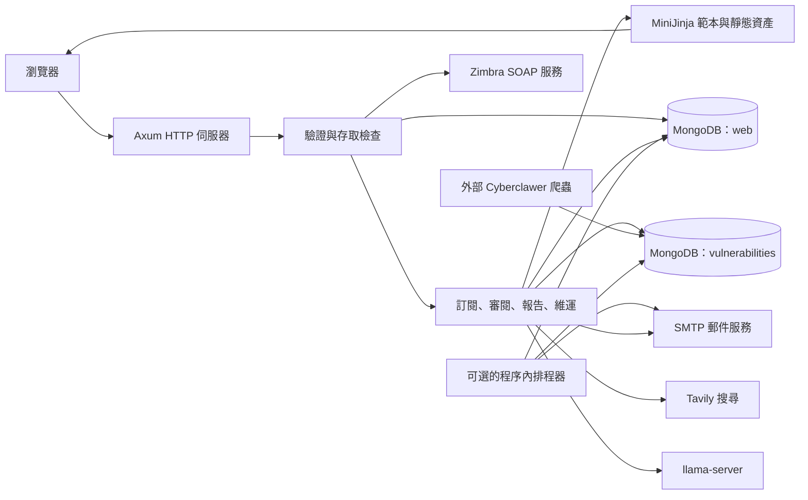
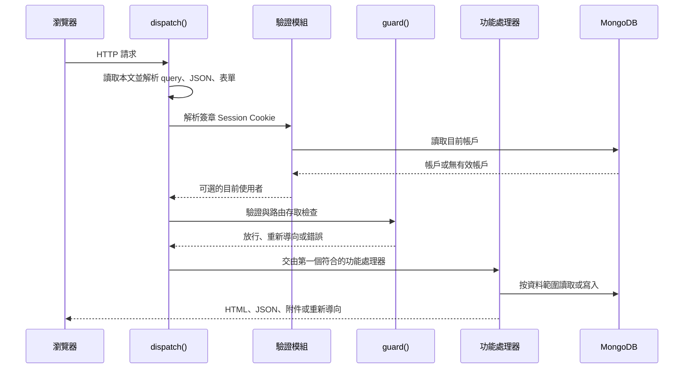
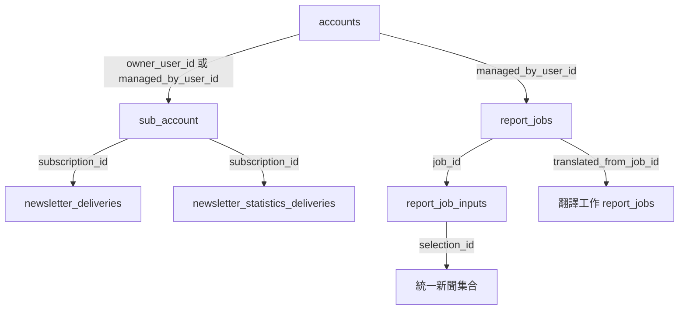
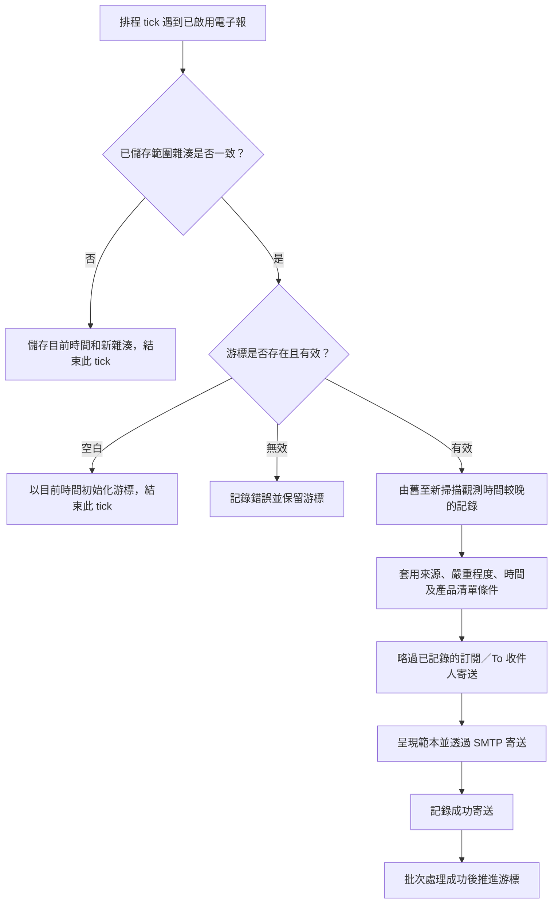
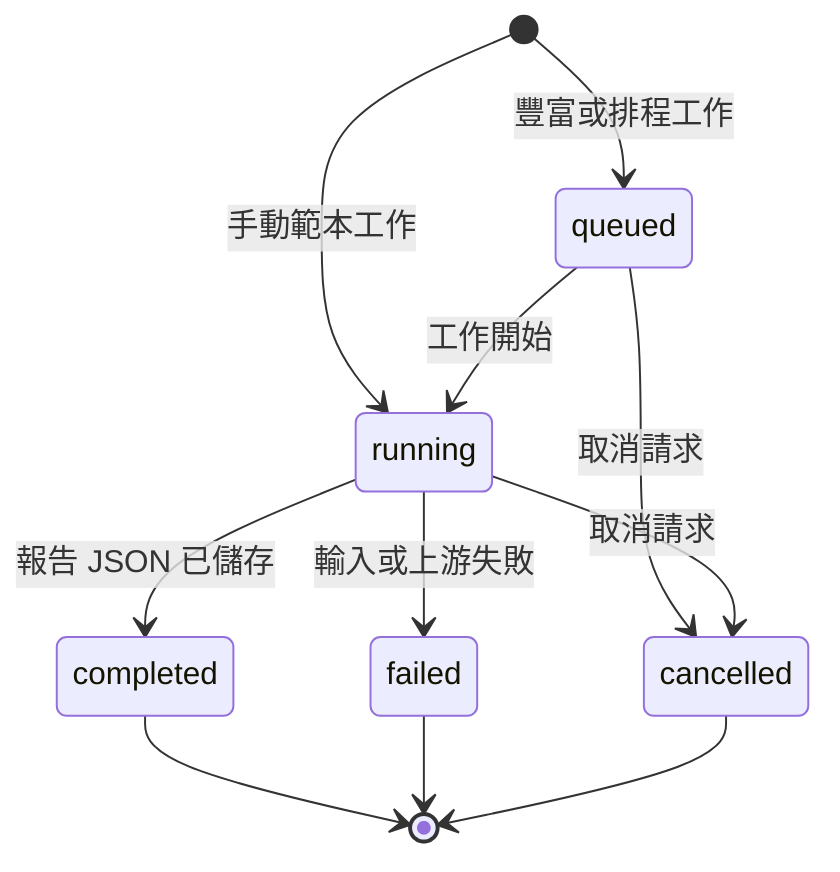

# 資安電子報入口網站 — 系統與開發者文件（繁體中文版）

本文件依據 **2026 年 11 月 6 日**的根目錄實作撰寫；分支為 `redesign/unified-news-collection`，來源提交為 `6aae75b`。

本指南介紹系統各部分如何協作，並提供開發、維運及擴充所需的資訊。文件範圍是根目錄的 `src/`、`templates/` 和 `static/` 實作；`worktrees/` 下的其他檢出版本不在此範圍。若設定名稱或舊檔案容易令人以為舊功能仍在使用，本文會說明目前實際啟用的行為。

## 目錄

1. [系統用途與邊界](#section-1)
2. [架構與技術](#section-2)
3. [專案目錄與模組](#section-3)
4. [啟動與請求處理](#section-4)
5. [帳戶、驗證與授權](#section-5)
6. [MongoDB 資料模型](#section-6)
7. [訂閱模型與生命週期](#section-7)
8. [篩選、產品清單比對與審閱選取](#section-8)
9. [電子報正規化與範本](#section-9)
10. [SMTP 寄送與電子報排程](#section-10)
11. [報告與翻譯](#section-11)
12. [每月寄送統計](#section-12)
13. [HTTP 端點參考](#section-13)
14. [設定參考](#section-14)
15. [本機開發與驗證](#section-15)
16. [部署、資料遷移與復原](#section-16)
17. [維運與疑難排解](#section-17)
18. [擴充方式與實作限制](#section-18)

<a id="section-1"></a>
## 1. 系統用途與邊界

本入口網站會將已收集的漏洞與資安公告轉成符合條件的電子報及 HTML 報告。使用者維護收件人和產品清單；管理員可審閱公告、產生報告、檢查寄送狀態及調整電子報呈現方式。

系統提供三種不同的寄送功能：

| 功能 | 輸入及觸發條件 | 輸出 |
| --- | --- | --- |
| 電子報動態 | 符合已啟用訂閱條件的新觀測記錄 | 每筆符合條件的公告，按每位 To 收件人寄出來源專屬格式的電子郵件 |
| 排程報告 | 到達 cron 排程時間時，符合已啟用報告設定檔的記錄 | 建立報告工作；完成後寄送摘要郵件 |
| 每月電子報統計 | 上一個香港時間日曆月份已成功寄送的電子報記錄 | 為每位 To 收件人寄送個人化數量及來源佔比 |

管理員也可以手動產生及翻譯報告。透過 Reports 頁面建立報告並不會寄給訂閱者。

### 1.1 本系統已實作的功能

- 使用 Rust 編寫 HTTP 伺服器，提供伺服器產生的頁面及 JSON 端點。
- Zimbra 身分驗證；Zimbra 要求時可輸入六位數驗證器代碼。
- 一個由設定指定、供復原及管理使用的本機管理員帳戶。
- 按擁有人範圍管理訂閱；電子報和報告設定檔可分開啟用。
- 匯入 CSV 產品清單，以確定性規則比對廠商及產品，並審閱公告。
- 正規化各來源的電子報內容，並預覽郵件。
- 固定範本報告及搜尋輔助的豐富報告。
- 在伺服器程序內執行排程，透過 SMTP 寄送並記錄歷史及每月統計。
- 互動式 Linux 安裝程式，支援 systemd、Docker Compose 或只準備設定。

### 1.2 外部系統

| 依賴 | 用途 | 下列功能需要此依賴 |
| --- | --- | --- |
| MongoDB | 儲存帳戶、訂閱、工作、寄送歷史及已收集新聞 | 伺服器啟動及一般運作 |
| Cyberclawer / `vuln-scrape` | 擷取資料、發布來源目錄、遷移舊新聞集合 | 建立及維護新聞資料集 |
| Zimbra | 驗證郵箱密碼、執行可選的雙重驗證、確認郵箱資料夾 | 一般使用者登入 |
| SMTP 伺服器 | 寄送所有應用程式郵件 | 訂閱通知及手動／排程郵件 |
| Tavily | 搜尋已選 CVE 的佐證資料 | 豐富報告產生 |
| 相容的 `llama-server` 端點 | 產生 JSON 漏洞卡片及翻譯報告 JSON | 豐富報告及報告翻譯 |
| jsDelivr | 提供入口網站版面使用的 Bootstrap CSS、JavaScript 及 Bootstrap Icons | 完整瀏覽器樣式及對話框功能 |

爬蟲是另一個獨立應用程式。本專案不含爬蟲實作，也不會安裝 MongoDB。本文提到的爬蟲指令須在爬蟲所在環境執行。

### 1.3 現行與舊版概念

- **帳戶集合：** 預設為 `web.accounts`。伺服器不會讀取或遷移舊版 `web.auth` 和 `web.subscriptions`。
- **訂閱集合：** `web.sub_account`。訂閱記錄與登入帳戶是不同資料。
- **新聞集合：** 預設為單一實體集合 `vulnerabilities.news`。來源由 `source.provider` 指定。
- **舊審閱名稱：** 為相容舊連結，仍接受 `cve_review` 等部分名稱，但實際查詢統一集合。
- **AccountHub：** 舊範本、JavaScript、測試和 [APIs.md](../APIs.md) 仍保留在檔案樹中；本實作不再啟用 AccountHub 驗證或組織管理。
- **角色：** 目前沒有有效的副管理員或組織管理員層級。`is_admin()` 會呼叫 `is_top_admin()`；`is_organization_admin()` 一律回傳 `false`。
- **寄送方式：** 目前所有郵件都透過 SMTP 寄送。建立 Zimbra 資料夾不代表系統會把郵件投遞到該資料夾。`.env.example` 中關於 SMTP 的註解是舊版設計留下的；目前行為以 `src/mail.rs` 為準。

<a id="section-2"></a>
## 2. 架構與技術

本系統是模組化單體：單一執行檔負責 HTTP 處理、頁面呈現、背景報告工作及可選排程。MongoDB 是共用的持久化層；系統沒有獨立佇列服務或前端建置應用程式。



### 2.1 主要技術

套件名稱為 `webserver-rust`，版本 `0.1.0`，採用 Rust 2024 edition。Docker 建置映像和安裝程式以 Rust 1.91 為目標；實際依賴版本鎖定於 [Cargo.lock](../Cargo.lock)。

| 範疇 | 程式庫或作法 |
| --- | --- |
| HTTP 與非同步執行 | Axum 0.8、Tokio、`tower-http` 靜態檔案服務 |
| 資料儲存 | MongoDB Rust driver 3.9、BSON 文件 |
| 範本 | MiniJinja 2.24、檔案系統載入器及相容性輔助函式 |
| 資料格式 | Serde、`serde_json`、`serde_urlencoded`、`csv`、`multer` |
| 外部 HTTP | 使用 rustls 的 Reqwest |
| 郵件 | 支援 Tokio／rustls SMTP 的 Lettre |
| 本機密碼驗證 | bcrypt |
| Session 簽章 | HMAC-SHA256、URL-safe Base64 |
| Zimbra 密碼加密 | AES-256-GCM、隨機 12 位元組 nonce、一般 Base64 |
| 時間計算 | Chrono；排程使用固定 UTC+8 時差 |
| 日誌 | `tracing` 和 `tracing-subscriber` |
| 瀏覽器程式碼 | 原生 JavaScript、Bootstrap 5.3.3、Bootstrap Icons 1.11.3 |

### 2.2 共用應用程式狀態

[src/main.rs](../src/main.rs) 中的 `AppState` 會複製到各個處理器及背景工作，包含：

- `cfg`：載入後的設定和原始 JSON 設定物件。
- `web`：應用程式資料庫的連線控制代碼。
- `vuln`：漏洞資料庫的連線控制代碼。
- `templates`：共用的 MiniJinja 環境。
- `http`：用於報告搜尋及 LLM 請求的可重用 Reqwest 用戶端。

Zimbra 用戶端會另行建立 HTTP 用戶端，並套用 Zimbra 設定中的逾時及 TLS 憑證驗證選項。

<a id="section-3"></a>
## 3. 專案目錄與模組

### 3.1 後端

| 檔案 | 主要職責 |
| --- | --- |
| [src/main.rs](../src/main.rs) | 啟動、`AppState`、請求內容、中央存取防護、處理器派送及靜態檔案服務 |
| [src/config.rs](../src/config.rs) | 載入 `.env` 和 JSON、環境變數覆寫、預設值、執行期路徑 |
| [src/db.rs](../src/db.rs) | BSON／JSON 轉換、集合／查詢輔助函式、識別碼處理 |
| [src/auth.rs](../src/auth.rs) | 建立管理員、Session Cookie、本機／Zimbra 登入、2FA 挑戰及設定端點 |
| [src/zimbra.rs](../src/zimbra.rs) | 加密憑證及 Zimbra SOAP 驗證／資料夾操作 |
| [src/subscriptions.rs](../src/subscriptions.rs) | 訂閱擁有權、佈建、CRUD、設定檔驗證、CSV 匯入／匯出、設定檔比對及通知 |
| [src/vendor_matcher.rs](../src/vendor_matcher.rs) | 產品清單驗證、廠商／產品正規化、比對信心及佐證 |
| [src/reviews.rs](../src/reviews.rs) | 審閱篩選、顯示資料正規化、評分、自動選取及 JSON 匯出 |
| [src/newsletters.rs](../src/newsletters.rs) | 範本設定、預覽呈現及舊版靜態電子報發布 |
| [src/newsletter_normalizer.rs](../src/newsletter_normalizer.rs) | 將來源資料轉為共用電子報檢視模型並選擇範本 |
| [src/newsletter_normalizer/splunk.rs](../src/newsletter_normalizer/splunk.rs) | Splunk 描述、結構化表格及來源順序保留 |
| [src/reports.rs](../src/reports.rs) | 工作生命週期、固定／豐富報告產生、上傳、翻譯、HTML 呈現、歷史、取消及刪除 |
| [src/scheduler.rs](../src/scheduler.rs) | 每 30 秒輪詢、電子報游標、排程報告、寄送記錄及心跳 |
| [src/cron_schedule.rs](../src/cron_schedule.rs) | 五欄 cron 解析及香港時間下一次執行時間計算 |
| [src/newsletter_statistics.rs](../src/newsletter_statistics.rs) | 每月彙整、個人化 HTML、寄送宣告、寄送日誌及重試狀態 |
| [src/mail.rs](../src/mail.rs) | 建立 SMTP 傳輸、HTML MIME 郵件、逐一寄送 To 並處理 CC/BCC |
| [src/view.rs](../src/view.rs) | MiniJinja 環境、翻譯／URL 輔助函式、回應輔助函式及 Cookie 解析 |

### 3.2 頁面與瀏覽器資產

| 位置 | 用途 |
| --- | --- |
| [templates/layouts/base.html](../templates/layouts/base.html) | 共用導覽、版面、CDN 依賴及目前使用者資訊 |
| `templates/auth/` | 登入、設定及保留的舊版管理範本 |
| `templates/subscriptions/` | 訂閱編輯器及通知／統計郵件範本 |
| `templates/reviews/` | 統一審閱頁面及集合瀏覽器 |
| `templates/reports/` | 報告歷史／編輯頁及兩種報告輸出格式 |
| `templates/operations/` | 排程狀態、來源清單及電子郵件範本編輯器 |
| `templates/newsletters/` | 產生式／來源專屬郵件範本及三個舊版公開 HTML 檔案 |
| `templates/errors/` | 禁止存取及找不到頁面 |
| `static/js/` | 頁面控制器、共用來源選擇器、翻譯輔助程式及郵件預覽輔助程式 |
| `static/css/`、`static/images/` | 樣式表及 404 頁圖片 |

範本環境提供 `t()`、`url_for()` 和 `nl2br`。`url_for()` 是手動維護的端點名稱對 URL 對照，不會從 Axum 路由自動產生。翻譯字串透過 [config/translations.json](../config/translations.json) 編譯進執行檔。

目前 `page_context()` 將入口網站頁面語系固定為英文。舊有中文翻譯目錄仍供範本和測試使用；報告翻譯則有獨立處理方式。

審閱選取項目存於瀏覽器 `localStorage` 的 `vulnerabilityReviewSelections`，選取的報告模式存於 `vulnerabilityReportGenerationMode`。這些選取狀態只在瀏覽器本機保存，不會同步成帳戶資料庫記錄。進行中的報告工作大約每兩秒輪詢一次；Operations 頁面每二十秒更新狀態。

### 3.3 建置、設定與部署檔案

- [Cargo.toml](../Cargo.toml)、[Cargo.lock](../Cargo.lock)：套件與依賴定義。
- [.env.example](../.env.example)：環境變數範本；部署時應複製並填入實際值。
- [config/config.json](../config/config.json)：JSON 預設值，包含部分目前流程未使用的保留設定。
- [setup.sh](../setup.sh)：可獨立執行的互動式 Linux 安裝／更新程式。
- [tests/test_setup.py](../tests/test_setup.py)：安裝程式設定、檢出還原、啟用及復原測試。
- [Dockerfile](../Dockerfile)、[docker-compose.example.yml](../docker-compose.example.yml)：建置及候選部署範例。
- [README.md](../README.md)：精簡的安裝與操作說明。
- [DEPLOY_REPORT_PREVIEW_FIX.md](../DEPLOY_REPORT_PREVIEW_FIX.md)：報告預覽修正的部署指南。
- [APIs.md](../APIs.md)：保留的外部 AccountHub API 資料，並非本入口網站的 HTTP API 參考。

<a id="section-4"></a>
## 4. 啟動與請求處理

### 4.1 啟動順序

`main()` 在接收 HTTP 流量前會依序執行：

1. 初始化 tracing。`RUST_LOG` 可覆寫預設篩選值 `webserver_rust=info,tower_http=info`。
2. 解析 `WEBSERVER_ROOT`；若未設定，使用 Cargo 編譯時記錄的 manifest 目錄。
3. 載入 `<root>/.env` 及由 `APP_CONFIG` 指定的 JSON 設定檔。
4. 建立 MongoDB 用戶端，選取應用程式資料庫及漏洞資料庫。
5. 建立範本環境及共用報告 HTTP 用戶端。
6. 執行 `auth::ensure_bootstrap()`：建立帳戶索引和挑戰 TTL 索引，然後建立或更新設定指定的本機管理員。
7. 為仍啟用的 Zimbra 帳戶補建訂閱。這個階段若失敗會寫入日誌，但不會阻止伺服器啟動。
8. 只有 `RUST_SCHEDULER_ENABLED` 為真值時才啟動排程器。
9. 綁定 `0.0.0.0:<PORT>`，從磁碟服務 `/static`，其他請求交由 `dispatch()` 處理。

MongoDB 帳戶／索引／管理員初始化失敗會令啟動中止。因此登入頁能正常回應，代表的不只是 TCP 連接埠已開啟，但仍不能證明 Zimbra、SMTP、Tavily 或 LLM 可正常使用。

**每次重新啟動都會執行管理員初始化：**系統會用 `WEB_AUTH_BOOTSTRAP_PASSWORD` 再次建立 bcrypt 雜湊並寫入密碼，同時啟用帳戶、設為 `role=admin`，並將 `must_change_password` 清除。在 Settings 修改密碼不會同步更改該環境變數。若有意更改密碼，請同步更新部署設定；否則重新啟動時仍會套用設定中的密碼。變更 bootstrap 使用者名稱時，系統可能會沿用既有本機管理員記錄。

### 4.2 請求內容與派送



`ReqCtx` 保存 HTTP 方法、路徑、重複 query 參數、標頭、緩衝後的本文、解析出的 JSON、表單欄位，以及可選的帳戶文件。提供 `arg()`、`args()`、`field()`、`user_id()` 和 `owner_filter()` 等存取方法。

中央本文大小上限為 **25 MiB**。本文會在存取防護執行前先讀入記憶體。系統會嘗試解析 JSON 和 URL-encoded 表單；multipart 端點則自行解析已緩衝的本文。

通過存取防護後，路由派送順序如下：

```text
根路徑重新導向 → auth → subscriptions → reviews → reports → operations
                → newsletters → locale/image 相容路由 → 404
```

若模組沒有處理該請求，便回傳 `None` 讓下一個模組檢查。許多路徑會自行比對 HTTP 方法；不支援的方法通常落到 HTML 404，而非統一的 JSON 405。

### 4.3 存取檢查

- 未登入的 API 呼叫通常收到 `401 {"error":"Authentication required"}`。
- 未登入的頁面請求會轉至 `/login?next=...`。
- `must_change_password` 帳戶只可使用 Settings、密碼變更及登出；其他請求會被阻擋或轉址。
- Reviews、Reports、產生式電子報預覽及 Operations API 需要管理員權限。
- Operations 頁面、範本編輯、來源清單、快取清除及舊版發布功能需要最高管理員權限。
- Subscription 處理器會在中央防護之後再檢查資料擁有權。
- `/static/*`、登入路由、語系相容路由、`/image/*` 及舊版公開電子報頁面皆可公開存取。

目前「管理員」與「最高管理員」的判斷條件相同。中央防護中保留的不同名稱是相容結構，不代表系統有其他有效角色。

<a id="section-5"></a>
## 5. 帳戶、驗證與授權

### 5.1 目前權限一覽

| 功能 | Zimbra 使用者 | 設定指定的本機管理員 |
| --- | --- | --- |
| 登入 | `/login`，Zimbra 可要求 2FA | `/login/local` |
| 查看自己的設定 | 可以 | 可以 |
| 更改入口網站電郵／密碼 | 由 Zimbra 管理；入口網站拒絕修改 | 可以，但重新啟動會重新套用 bootstrap 設定 |
| 列出及編輯訂閱 | 自己擁有的記錄及由自己建立的本機記錄 | 所有記錄 |
| 新增訂閱 | 可以 | 可以 |
| 刪除自動建立的 Zimbra 訂閱 | 不可以 | 處理器允許刪除，但後續佈建可能重新建立 |
| 刪除手動建立的訂閱 | 在自己擁有的範圍內 | 可以 |
| 審閱漏洞及匯出選取項目 | 不可以 | 可以 |
| 產生、翻譯、取消或刪除報告工作 | 不可以 | 可以 |
| Operations 及電子報範本編輯器 | 不可以 | 可以 |
| AccountHub 組織／副管理員管理 | 無法使用 | 無法使用 |

本機管理員必須同時符合 `auth_source=local`、`role=admin`，而且正規化後的使用者名稱等於 `WEB_AUTH_BOOTSTRAP_USERNAME`。單純把任意 Zimbra 帳戶的 `role` 欄位改成 `admin` 不會授予管理員權限。

### 5.2 本機登入

`POST /login/local` 會正規化使用者名稱、查詢本機帳戶、確認帳戶已啟用，並驗證 bcrypt 密碼。成功後會建立入口網站 Session Cookie，並轉至安全的站內 `next` 路徑；若沒有有效路徑則轉至 `/subscriptions`。

密碼驗證要求密碼非空且不超過 72 位元組；沒有規定最低長度或複雜度。請設定強度足夠的管理員密碼。既有 Session Cookie 不含密碼版本，因此更改密碼不會撤銷所有已登入的 Session。

### 5.3 Zimbra 登入

1. 正規化完整郵箱地址，並確認已提供密碼。
2. 對 `<ZIMBRA_BASE_URL>/service/soap` 傳送 `AuthRequest`。
3. 若 Zimbra 要求 2FA，進入下方的挑戰流程。
4. 使用 `ZIMBRA_CREDENTIAL_KEY` 加密提交的郵箱密碼。
5. 使用已驗證的 Session 傳送 `GetFolderRequest`；若找不到指定資料夾，再傳送 `CreateFolderRequest`。
6. 建立或更新 Zimbra 帳戶記錄：目前電郵／使用者名稱、`role=user`、加密密碼、資料夾識別碼及登入時間。
7. 確保帳戶有自動建立的訂閱。
8. 發出簽章後的入口網站 Session Cookie。

成功登入包括資料夾和訂閱設定。即使 Zimbra 驗證成功，若後續設定失敗，入口網站仍可能回傳 `503`。每次成功登入也會更新 Zimbra 帳戶的啟用狀態及保存的憑證。

資料夾預設名稱為 `news`。目前排程器透過 SMTP 寄信，不會使用保存的 Zimbra 密碼寄送。

### 5.4 雙重驗證挑戰

瀏覽器會收到路徑限制在 `/login` 的不透明 `zimbra_2fa_challenge` Cookie。MongoDB 保存其隨機識別碼的 SHA-256 雜湊、加密後的密碼及 Zimbra 臨時 token、目標重新導向路徑、到期時間和嘗試次數。

- 最長有效時間 300 秒；若 Zimbra 提供較短期限則採用較短時間。
- 驗證碼必須剛好是六位 ASCII 數字。
- 最多失敗五次；達上限後會刪除挑戰。
- 應用程式查詢會檢查到期時間，MongoDB TTL 索引也會清理過期記錄。
- 完成時會將臨時 token 和驗證碼傳給 Zimbra，再接續一般的資料夾／帳戶／訂閱設定。
- 取消、成功完成及部分不可復原錯誤會刪除挑戰並清除 Cookie。
- 上游服務暫時無法使用時，挑戰可能會保留至過期，讓使用者重試。

登入頁只顯示遮罩後的電郵地址，不會向瀏覽器暴露加密密碼或臨時 token。

### 5.5 Session 與機密資料

`rust_session` 內含 URL-safe Base64 內容，記錄帳戶 ID、驗證來源及到期時間，並附有使用 `FLASK_SECRET_KEY` 產生的 HMAC-SHA256 簽章。內容只有簽章保護，並未加密。有效期為十二小時（`Max-Age=43200`）。

每個經派送的請求都會驗證簽章和期限，再從 MongoDB 重新讀取帳戶。已停用帳戶或驗證來源不相符的 Cookie 會被拒絕。登出只清除瀏覽器 Cookie，系統沒有伺服器端的 Session 撤銷清單。

兩種驗證 Cookie 都設有 `HttpOnly` 和 `SameSite=Lax`。程式沒有設定 `Secure`，亦沒有另外實作 CSRF token。部署時須設定 HTTPS 終止及相關 Cookie 標頭政策；不要只因 Cookie 名稱或上游使用 HTTPS 就假設已有這些保護。

Zimbra 機密使用 AES-256-GCM 和新產生的隨機 nonce，加密後以 `base64(nonce || ciphertext || tag)` 保存。設定金鑰必須能解碼成 32 位元組。多個共用加密憑證的執行個體必須使用相同金鑰。本專案沒有自動輪替金鑰或批次重新加密工具。

<a id="section-6"></a>
## 6. MongoDB 資料模型

資料庫名稱、帳戶集合名稱及新聞集合名稱可設定。下表中的其他應用程式集合名稱由程式直接指定。系統以動態 BSON／JSON 文件表示資料，沒有使用資料庫 schema validator 強制欄位結構。

### 6.1 集合一覽

| 資料庫 | 集合／索引鍵 | 內容及生命週期 |
| --- | --- | --- |
| 應用程式（`web`） | `accounts` 或 `ACCOUNT_COLLECTION` | 本機管理員及 Zimbra 身分 |
| 應用程式 | `zimbra_login_challenges` | 暫存的加密 2FA 狀態；以 TTL 清理 |
| 應用程式 | `sub_account` | 訂閱擁有權、收件人、設定檔及排程狀態 |
| 應用程式 | `newsletter_deliveries` | 每個訂閱、To 收件人和來源記錄的成功 SMTP 提交 |
| 應用程式 | `newsletter_statistics_deliveries` | 每個訂閱、月份及 To 收件人的統計郵件檢查點 |
| 應用程式 | `newsletter_template_config`，`_id="newsletter_default"` | 共用主旨／額外內容／頁尾及來源欄位順序 |
| 應用程式 | `scheduler_health`，`_id="email_scheduler"` | 最後排程時間、程序資訊及近期電子報狀態 |
| 應用程式 | `report_jobs` | 產生／翻譯狀態、進度、報告 JSON、日誌及寄送結果 |
| 應用程式 | `report_job_inputs` | 工作所需的有序來源參照或上傳記錄 |
| 應用程式 | `report_job_results` | 刪除時會嘗試清除；目前產生流程不會寫入此集合 |
| 應用程式 | `source_evidence_cache`、`search_enrichment_cache` | 舊版快取清除端點可處理；目前豐富報告不讀寫快取 |
| 漏洞資料庫（`vulnerabilities`） | `news` 或 `VULNERABILITIES_COLLECTION` | 由爬蟲維護的統一來源新聞記錄 |
| 漏洞資料庫 | `source_catalog`，`_id="active"` | 爬蟲發布的來源清單，供訂閱驗證及選擇器使用 |

### 6.2 帳戶文件

共用欄位包括 `_id`（ObjectId）、`username`、`username_key`、`auth_source`、`role`、`disabled`、`must_change_password`、`created_at` 和 `updated_at`。

| 帳戶類型 | 額外欄位 |
| --- | --- |
| 本機帳戶 | `password` 保存 bcrypt 雜湊；`email`／`email_key` 可選 |
| Zimbra 帳戶 | `email`、`email_key`、加密的 `zimbra_password`、`zimbra_folder_id`、`zimbra_folder_path`、`last_login_at`；組織資訊可選 |

`username_key` 和 `email_key` 是轉為小寫的查詢鍵。`public_user()` 只回傳明確列出的安全欄位，不會回傳密碼或加密憑證。

伺服器啟動時會建立：

| 索引名稱 | 鍵 | 選項 |
| --- | --- | --- |
| `accounts_username_unique` | `username_key: 1` | 唯一 |
| `accounts_email_unique` | `email_key: 1` | 唯一、稀疏 |
| `zimbra_2fa_challenge_expiry` | `expires_at: 1` | TTL，延遲 0 秒 |

若現有帳戶鍵有重複值，索引建立可能失敗並阻止啟動。系統不會自動合併重複帳戶或遷移舊帳戶。

### 6.3 統一新聞資料格式

以下是 MongoDB Extended JSON 範例，只作說明；入口網站不會用它建立強制 schema：

```json
{
  "_id": "cve:CVE-2026-12345",
  "code": "CVE-2026-12345",
  "title": "Example product vulnerability",
  "severity": "High",
  "observed_at": {"$date": "2026-11-06T02:00:00Z"},
  "source": {
    "provider": "cve",
    "url": "https://vendor.example/advisories",
    "detail_url": "https://vendor.example/advisories/CVE-2026-12345"
  },
  "details": {
    "description": "A description supplied by the source.",
    "affected": [{"vendor": "Example Vendor", "product": "Example Product"}],
    "recommendations": ["Apply the vendor update."],
    "references": ["https://vendor.example/advisories/CVE-2026-12345"]
  }
}
```

整合時要留意：

- `_id` 必須穩定。解析記錄時會先以字串 ID 查詢，再嘗試把相同字串解析成 ObjectId。
- `source.provider` 用來篩選及標示來源、正規化資料和彙整寄送歷史。
- `observed_at` 是爬蟲觀測／匯入時間，供排序、擷取時間篩選及電子報游標使用，不保證等於廠商發布時間。
- 排程器的時間範圍查詢需要 BSON DateTime。部分轉換工具也接受 RFC3339 字串，但 MongoDB 範圍條件使用 BSON DateTime。
- 報告產生需要 `details` 物件；其中可保留來源專屬欄位。
- 設定檔／審閱資料庫查詢使用頂層嚴重程度。顯示資料正規化可補足畫面缺漏欄位，但不會改寫資料庫記錄，也不會自動修正查詢結果。
- `source.url` 是來源清單的主要 URL；`source.detail_url` 是個別公告連結。

審閱路由為舊連結接受的名稱包括：`avd_review`、`cnvd_review`、`cve_review`、`github_advisory_review`、`hkcert_review`、`hpe_review`、`huawei_sa_review`、`juniper_review`、`msrc_review`、`nvd_review`、`paloalto_review`、`qianxin_review`、`splunk_review` 和 `zimbra_review`。這些名稱都會查詢統一集合，不需要 MongoDB review view。

### 6.4 來源目錄

訂閱功能預期使用以下格式的目錄文件：

```json
{
  "_id": "active",
  "providers": ["cve", "nvd", "github_advisory", "hkcert", "zimbra"]
}
```

清單必須只包含不重複且非空的字串。實際使用時要填入爬蟲的來源 ID；以上僅為範例，並非完整清單。即使某來源目前沒有新聞記錄，只要列在目錄中，仍可供使用者選取。

若目錄不存在或格式錯誤，來源選擇器／schema 查詢會失敗，設定檔驗證也會拒絕儲存，停用的設定檔亦然。入口網站會要求維運人員執行 `vuln-scrape sync-source-catalog`，但不會在啟動時自行建立目錄。

### 6.5 資料關聯與序列化



這些關聯由應用程式維護，並非資料庫外鍵。刪除不會在所有集合間級聯執行。例如，刪除訂閱不會清除電子報歷史；刪除報告也不會連帶刪除其獨立的翻譯工作。

API 序列化日期及部分巢狀 ID 時使用 BSON JSON 格式。公開的訂閱／工作根文件會把 ObjectId `_id` 轉成 `id` 字串，並移除部分內部欄位。不要假設所有回應日期都是一般 ISO 字串；瀏覽器輔助程式也會處理 Extended JSON 日期。

<a id="section-7"></a>
## 7. 訂閱模型與生命週期

### 7.1 身分、擁有權與收件人

訂閱記錄包含 `username`、`emails`（To）、可選的 `cc` 和 `bcc`、相容欄位 `email`（第一個 To）、`organization`、寄送設定檔、時間戳及擁有權標記。

有兩種擁有權形式：

| 類型 | 擁有權欄位 | 意義 |
| --- | --- | --- |
| 綁定帳戶的 Zimbra 訂閱 | `owner_user_id`，通常亦有 `managed_by_user_id`；`zimbra_email` 可選 | 訂閱屬於入口網站帳戶 |
| 本機建立的收件人訂閱 | `local_subscription=true`、`managed_by_user_id` | 建立者管理收件人清單；這不會建立新的登入帳戶 |

本機訂閱的 organization 只作顯示資訊，不會授予存取權。Zimbra 使用者的帳戶訂閱及自己建立的本機訂閱會一併顯示；設定指定的本機管理員則能查看所有記錄。

自動建立的 Zimbra 訂閱具有 `auto_provisioned=true` 和 `local_subscription=false`。初始 To 收件人是該郵箱，兩個設定檔都停用。伺服器啟動補建及登入時的佈建會保留已設定的收件人／設定檔、沿用符合條件的舊 Rust 訂閱，並移除部分重複的自動／預設記錄。這些整理不會遷移舊 AccountHub 或 `web.subscriptions` 資料。

使用者可以把 To 改成外部地址，不必包含自己的郵箱；訂閱擁有權仍綁定原帳戶。Zimbra 使用者不能刪除自動建立的記錄，但可在自己的權限範圍刪除額外手動建立的訂閱。

### 7.2 收件人驗證及寄送規則

- `emails` 是包含 1 至 50 個地址的陣列。若沒有 `emails`，相容欄位 `email` 可以提供一個地址。
- `cc` 和 `bcc` 是可選陣列，預設為空。
- 地址會先移除前後空白並轉為小寫，解析成電郵地址後依 To → CC → BCC 順序跨群組去重。
- 三組合計最多可有 50 個不重複地址。
- 每個 To 地址會收到獨立郵件；每封郵件也會寄一份給 CC 和 BCC。
- BCC 地址會加入 SMTP 信封收件人，但不會出現在已序列化的郵件標頭。

### 7.3 獨立設定檔

以下是可參考的 API 請求。後端會合併預設的設定檔／篩選條件，因此呼叫端不必填上所有預設欄位。來源名稱必須存在於爬蟲目錄。

```json
{
  "username": "Example operations recipients",
  "local_subscription": true,
  "organization": "Example Team",
  "emails": ["security@example.com"],
  "cc": [],
  "bcc": [],
  "newsletter_profile": {
    "enabled": true,
    "statistic_schedule_enabled": true,
    "filters": {
      "collections": ["cve", "hkcert"],
      "status": ["Critical", "High"],
      "include_unknown": false,
      "vendor_product_filter": {
        "enabled": false,
        "schema_version": 1,
        "include_possible_matches": false,
        "rows": []
      }
    }
  },
  "report_profile": {
    "enabled": true,
    "generation_mode": "template",
    "report_language": "en",
    "search_prompt": "",
    "schedule_enabled": false,
    "cron_expression": "0 9 * * 1",
    "filters": {
      "collections": ["cve"],
      "status": ["Critical", "High"],
      "include_unknown": false,
      "time_window": "week"
    }
  }
}
```

內部會把選取的來源正規化到 `filters.sources`，並將 `filters.collections` 設為實體集合。公開訂閱回應會為了相容前端，再顯示邏輯來源名稱。新的整合程式應同時理解這兩個欄位，不要把每個來源當成獨立 MongoDB 實體集合。

預設電子報設定檔：停用、沒有選取來源、沒有寄送游標、停用每月統計。

預設報告設定檔：停用、CVE 範圍、`template` 模式、英文、停用排程、每星期一香港時間 09:00。豐富報告會正規化為 CVE 範圍。舊版報告表單儲存的空來源選取也會修正為 CVE；但選取模式下沒有來源的電子報設定檔不會比對任何資料。

### 7.4 儲存、預覽與通知行為

`POST /api/subscriptions/preview` 會驗證及正規化設定檔，但不儲存資料。它不是完整模擬：不會執行收件人驗證、重複檢查或所有最終寫入時的擁有權條件。

新增、更新及刪除會先寫入 MongoDB，再同步嘗試寄送訂閱通知。若 SMTP 失敗，端點會回傳 `503`，訊息可能是「Subscription was saved, but the notification email could not be sent.」。**資料庫變更此時已經完成。**重試新增或刪除前先重新整理清單。資料庫操作和郵件寄送沒有 outbox 或交易保護。

更新時會將提交資料合併至已儲存資料。省略 CC/BCC 欄位會保留舊值；明確傳入空陣列則會清除該收件人群組。綁定帳戶訂閱的身分欄位比收件人／設定檔欄位有更嚴格的編輯限制。

`POST /api/subscriptions/{id}/run` 只回傳符合條件的審閱選取項目及數量，不會建立報告工作或寄送郵件。建立報告要另外呼叫管理員端點。

<a id="section-8"></a>
## 8. 篩選、產品清單比對與審閱選取

### 8.1 篩選流程

系統有兩條相關但不同的處理流程：

| 流程 | 主要實作 | 行為 |
| --- | --- | --- |
| 管理員審閱搜尋 | `reviews::filter()` + `filtered_rows()` | 必須提供已啟用的產品清單；支援審閱擷取時間範圍，匹配後再由前端分頁 |
| 訂閱／報告比對 | `subscriptions::profile_filter()` + `match_profile*()` | 使用已儲存的設定檔／來源條件及可選產品清單；供預覽及排程器使用 |

不能假設其中一條流程接受的所有篩選條件，在另一條流程中有相同意義。

設定檔篩選包括來源範圍、不區分大小寫且已跳脫特殊字元的文字條件、嚴重程度／狀態、可選嚴重程度門檻、觀測時間範圍、可選的 `report_scope.kev_only` 及廠商／產品清單。選取模式下來源清單為空，結果就是不匹配任何記錄。設定檔的 `daily` 從香港時間當日午夜開始；`week` 是最近七日的滾動範圍。

目前設定檔查詢器**不會套用自訂 `start`／`end` 範圍**，即使編輯器會保存和顯示這些值。審閱篩選有實作自訂時間範圍。訂閱自訂範圍目前屬於實作缺口；若需要有界時間範圍，請使用已實作的 `daily` 或 `week`。

審閱搜尋支援 `all`、`daily`、`week`、相容值 `24h`、`7d`、`30d` 及 `custom`。自訂時間接受 RFC3339，或以香港時間解讀的本機格式 `YYYY-MM-DDTHH:MM[:SS]`。開始時間包含在範圍內，結束時間不包含。審閱搜尋／自動選取端點會拒絕非空自由文字 `search`，因為此處要求使用產品清單。

已知嚴重程度為 Critical、High、Medium、Low。設定檔比對也接受後綴為 `Risk` 的值。未選嚴重程度時通常包含所有已知級別；未知嚴重程度要明確設為 `include_unknown`，但 Zimbra 來源沒有嚴重程度的情況有相容性例外。

審閱 JSON 請求中的 `filter_arg()` 目前會讀取字串／數字，而非 JSON 布林值。直接呼叫並需要包含未知嚴重程度時，請傳入 `"include_unknown":"true"`；目前瀏覽器會傳布林值，而此路徑不會將其識別為 true。此問題不影響已儲存訂閱設定檔中的布林值。

### 8.2 匯入與匯出產品清單

CSV 欄位必須依照以下順序：

```csv
vendor,product,vendor_aliases,product_aliases
Red Hat,Enterprise Linux,"Red Hat, Inc.|RedHat",RHEL|Red Hat Enterprise Linux
Microsoft,Windows Server,Microsoft Corporation,Windows Server 2019|Windows Server 2022
```

- 匯入端點：`/api/subscriptions/vendor-product-import`，multipart 欄位名稱為 `file`。
- 檔案上限 1 MiB；需有 1 至 500 筆資料列。
- `vendor` 和 `product` 必填；多個別名以 `|` 分隔。
- 匯入只回傳產品清單物件，不會自動儲存訂閱。
- 設定檔驗證另外限制每個欄位最多十個別名，每個身分／別名最多 200 字元，所有文字合計最多 100,000 字元；`unknown`、`*` 等無效身分會被拒絕。
- 已儲存清單的匯出路徑是 `/api/subscriptions/{id}/vendor-products.csv?profile=newsletter` 或 `profile=report`（預設）。匯出的資料只包含已儲存內容，使用相同四個 CSV 欄位及擁有權檢查，不包含編輯器尚未儲存的變更。

產品清單 JSON 使用第 1 版 schema：

```json
{
  "enabled": true,
  "schema_version": 1,
  "include_possible_matches": false,
  "rows": [
    {
      "vendor": "Microsoft",
      "product": "Windows Server",
      "vendor_aliases": ["Microsoft Corporation"],
      "product_aliases": ["Windows Server 2022"],
      "row_number": 2
    }
  ]
}
```

### 8.3 比對演算法

`vendor_matcher::classify()` 會回傳第一筆符合條件的清單列及其佐證；若沒有匹配則回傳空值：

| 信心級別 | 規則 |
| --- | --- |
| `confirmed`（已確認） | 同一來源資料中的結構化廠商／產品組合，符合正規化後的主要身分或別名 |
| `probable`（可能） | 找不到完整結構化配對時，允許檢查的單一文字片段同時包含廠商及產品身分 |
| `possible`（可能匹配） | 必須明確啟用；沒有可用的結構化廠商；清單產品身分具辨識度且不會在清單不同廠商間造成歧義；文字比對時亦須通過其他廠商檢查 |

比對前會把文字轉為小寫、統一標點／空格，並移除廠商名稱常見公司後綴。大部分文字使用詞組邊界比對；CJK 文字使用允許空格差異的比對。只有產品文字的比對會排除通用且過短的產品名稱。

結構化輸入包括頂層 vendor/product、多種 `details` 格式、CVE CNA affected 資料、affected-product 陣列及套件中繼資料。文字備援只檢查指定的標題、描述及受影響欄位，不會搜尋 JSON 中每個字串。

佐證會包含來源路徑、匹配的廠商／產品、清單列號，以及結構化組合或文字片段。這些信心級別是比對啟發式，無法證明部署中的特定版本真的受漏洞影響。目前清單 schema 不會比對版本範圍。

### 8.4 審閱流程與排序

審閱回應包含實體集合、來源、穩定的 `selection_id`、正規化後的顯示文件及產生式電子報預覽 URL。正規化會從來源詳細資料填補空白顯示欄位，同時保留既有非空欄位；不會把這些顯示用變更寫回 MongoDB。

搜尋預設第 1 頁、每頁 25 筆，頁面大小可設為 1 至 100。資料庫篩選後，Rust 程式才會執行產品清單比對。一般搜尋可能會先把所有候選資料載入記憶體再分頁，因此大型資料集應縮小搜尋條件。

自動選取接受 1 至 500 筆的要求數量；匹配候選超過 2,000 筆便會拒絕。系統依重要性排序、按解析出的 CVE ID 去重，並排除沒有 CVE ID 的記錄。目前評分方式：

- 基礎分數：Critical 45、High 35、Medium 22、Low 10、Unknown 8。
- 已知遭利用旗標：加 25 分。
- 主動遭利用文字：加 12 分；若沒有，公開漏洞利用程式／PoC 文字則加 6 分。
- 遠端程式碼執行／勒索軟體／面向網際網路／權限相關文字：加 8 分。
- 最終分數上限為 100；修補優先級由分數、嚴重程度及已知遭利用旗標判定。

這是應用程式內部的啟發式，不是外部風險標準。選取／匯出參照包含 `collection` 和 `selection_id`。JSON 匯出最多解析 500 筆，並保留來源原始文件，以便日後上傳到固定範本報告。

<a id="section-9"></a>
## 9. 電子報正規化與範本

### 9.1 共用電子報檢視模型

`newsletter_normalizer::normalize(document, provider, config)` 會將不同來源的資料轉為呈現欄位，例如：

```text
title, collection, overview, overview_blocks, severity, cvss,
impacts, affected, affected_table, cves, recommendations,
references, related_links, table, labels, subject, extra, footer,
field_order, 顯示旗標及來源專屬欄位
```

正規化器會擷取來源專屬描述、CVE ID、CVSS 值、受影響系統、結構化表格、修復建議及 URL。標題／概要缺失時會填入明確的預設文字。URL 會經過通訊協定篩選；HPE 和 Zimbra 只接受 HTTPS 連結。部分來源使用中文標籤，是因為來源格式本身為中文。

目前明確處理的來源分支包括 AVD、Cisco、CNVD、CNNVD、NVD、CVE、GitHub Advisories、HKCERT、Huawei、GovCERT／InfoSec、Juniper、Palo Alto、Splunk、FortiGuard、QiAnXin、Hikvision、Ransomware.live、zero-day 記錄、HPE 及 Zimbra。未知來源使用通用備援格式。這些程式分支不等於爬蟲目前啟用的來源目錄。

### 9.2 範本選擇

| 來源 | 範本 |
| --- | --- |
| `github_advisory` | `newsletters/github_advisory.html` |
| `hpe` | `newsletters/hpe.html` |
| `nvd` | `newsletters/nvd.html` |
| `zimbra` | `newsletters/zimbra.html` |
| 其他來源 | `newsletters/generated.html` |

GitHub 正規化會建立結構化公告／套件區塊及文字／Markdown 區塊。HPE 會抽取公告專屬段落。Splunk 透過獨立模組保留來源表格及相關文字。Zimbra 範本顯示版本、安全修正及套件資訊。

### 9.3 使用資料庫的範本編輯器

共用範本設定存於 `newsletter_template_config`：

```json
{
  "_id": "newsletter_default",
  "common": {
    "subject": "Security newsletter: {{title}}",
    "extra": "",
    "footer": ""
  },
  "sources": {
    "cve": {"fields": ["title", "overview", "severity", "affected", "cves", "references"]}
  }
}
```

正規化器接受以下欄位 ID，並依照設定順序呈現：`title`、`collection`、`overview`、`table`、`severity`、`cvss`、`impacts`、`affected`、`cves`、`recommendations`、`references`、`related_links`。正規化時會移除未知及重複 ID。

主旨只會直接替換 `{{title}}`、`{{collection}}` 及 `{{source_collection}}`，不是可執行任意邏輯的範本程式。共用額外內容／頁尾及來源欄位順序會套用至之後的正規化、預覽及寄送。

編輯器顯示的來源／範例，是新聞集合中每個來源最近觀測到的記錄。訂閱來源選擇器則使用爬蟲目錄，並會顯示目前沒有資料的來源。因此，有目錄但尚未產生記錄的來源，可以先供訂閱選取，之後才會出現在範本編輯器。

編輯器設定會在需要時從資料庫讀取；核心應用程式設定則於啟動時載入。更新範本只影響後續呈現，不會修改已寄出的郵件。

### 9.4 舊版公開電子報

`/en`、`/zh` 及 `/cn` 會直接回傳 `templates/newsletters/news_<language>.html`。只有管理員可用的 `/set-news` 端點會從 `NEWSLETTER_ROOT` 複製指定 HTML 檔案至其中一個目標檔，複製前會以實際路徑解析結果檢查檔案仍位於允許目錄內。發布後可透過未登入 URL 存取。

這個檔案發布流程與個別記錄預覽、排程 SMTP 電子報分開。若要使用此功能，請確保執行期檔案可寫入；否則重建容器時，映像檔中的範本可能會覆蓋修改內容。

<a id="section-10"></a>
## 10. SMTP 寄送與電子報排程

### 10.1 SMTP 傳輸

`mail::send()` 會依目前 SMTP 環境變數和設定的伺服器主機名稱建立 Lettre 傳輸。郵件內容是以 Base64 編碼的 HTML。

傳輸模式順序如下：

1. `SMTP_USE_SSL=true`：隱式 TLS relay。
2. 否則若 `SMTP_USE_TLS=true`（預設）：STARTTLS relay。
3. 否則使用未加密傳輸。

只有同時設定 SMTP 使用者名稱及密碼時才會附加登入憑證。`SMTP_FROM` 若未設定則採用 SMTP 使用者名稱。函式保留 delivery-mode 參數，但目前實作一定會逐一處理 To 收件人。

目前所有寄件者都使用此輔助函式：訂閱變更通知、新公告電子報、排程報告及每月統計。SMTP 成功代表傳輸服務接受郵件；入口網站不會處理退信或讀取回條。

### 10.2 排程器迴圈

排程器採選擇性啟用，並在 Web 伺服器程序中執行。第一次輪詢會等待 30 秒，之後每次依序：

1. 更新 `scheduler_health` 心跳。
2. 讀取最多 5,000 筆訂閱。
3. 若訂閱管理者已停用，而且有 `pause_managed_subscriptions_when_disabled` 旗標，則跳過該訂閱。
4. 檢查排程報告。
5. 檢查電子報寄送。
6. 檢查每月統計。

訂閱和以上檢查會逐一執行，但報告產生及報告完成後的監看會另外建立非同步工作。SMTP 或資料庫操作較慢時，會延遲後續訂閱並使心跳更新變慢。

**共用同一應用程式資料庫時，只應啟用一個排程器執行個體。**電子報和報告流程沒有分散式宣告鎖定。每月統計有宣告機制，但不會因此協調其他排程流程。

### 10.3 電子報游標生命週期



範圍雜湊包含 `enabled` 及整份已儲存篩選物件。範圍變更後，下一個啟用狀態的排程 tick 會把游標設為該 tick 的目前時間，不會補寄舊記錄。游標是在排程 tick 才重設，不是在使用者儲存時立即重設。只變更收件人不會改變此雜湊。

電子報比對會先取得觀測時間的高水位快照，再查詢 `(cursor, high_watermark]` 範圍，並由舊到新掃描。目標批次為 100 筆符合條件的記錄；若最後一筆時間相同的記錄超過 100 筆，會全部納入再停止，以免因時間戳相同而漏寄。若篩選後掃描完畢，即使沒有公告匹配，也可將游標推至快照的高水位。

每筆符合條件記錄和每位 To 收件人會使用以下組合作重複檢查：

```text
subscription_id + email + source_collection + selection_id
```

新歷史記錄包含 `source_provider`，`source_collection` 也保留作來源標示，並另外記錄漏洞資料庫的實體名稱。沒有 `subscription_id` 的舊歷史不會阻擋新訂閱寄送。

### 10.4 失敗與復原

查詢、呈現、SMTP 或歷史寫入失敗時，電子報流程會記錄錯誤並停止，不推進該批次游標。下次 tick 會略過之前已成功記錄的 To 寄送。

SMTP 和 MongoDB 之間沒有交易。如果 SMTP 已接受郵件，但資料庫未能寫入寄送記錄，下次 tick 可能再次寄出。伺服器啟動時不會建立電子報歷史唯一索引或分散式寄送鎖，因此這是重複抑制，不是 exactly-once 保證。CC/BCC 不會分別作為收件人寫入日誌；若另一個 To 收件人重試，CC/BCC 也可能再收到副本。

排程器更新成功狀態／游標也是獨立資料庫操作。調查未完成批次時，應同時查看 `last_error`、`last_success_at`、寄送歷史及游標。

<a id="section-11"></a>
## 11. 報告與翻譯

### 11.1 建立工作與資料儲存

手動建立報告時可使用以下其中一種輸入：

- JSON 欄位 `selections: [{"collection":"news","selection_id":"..."}]`。
- multipart 上傳欄位 `json_file`，內容為來源文件陣列，而且每筆 `details` 都必須是物件。

兩種方式皆接受 1 至 500 筆。上傳 JSON 上限是 20 MiB，低於中央 25 MiB 本文上限。豐富報告只接受 CVE 來源的選取項目，不接受 JSON 上傳。

請求範例：

```json
{
  "generation_mode": "template",
  "report_language": "en",
  "selections": [
    {"collection": "news", "selection_id": "cve:CVE-2026-12345"}
  ]
}
```

若使用不同的實體新聞集合，請在請求中使用已設定的集合名稱。伺服器會在建立工作前驗證選取項目，然後寫入有序的 `report_job_inputs`，並啟動 `reports::run()`。

建立工作回應為 `202`，包含 ID 和初始狀態。固定範本工作建立時先標示為 `running`；豐富報告先標示為 `queued`。兩種工作接著由同一個非同步 runner 處理。`queued` 不代表有獨立且持久的工作佇列。



Runner 最多讀取 500 筆輸入，解析新聞記錄參照或使用上傳內容，讀取來源期間檢查取消狀態、更新進度、產生報告，最後儲存報告 JSON 並標記完成。完成後會刪除輸入記錄；失敗或取消的輸入會保留至工作刪除為止。

伺服器啟動時不會執行復原流程來接續已中止的工作。程序中止後，資料庫中的 `queued`／`running` 狀態可能還在，但原本工作已消失。請管理員檢查狀態後，透過管理流程取消、刪除及重建這些工作。

### 11.2 固定範本

`template_report()` 會直接從來源欄位產生報告：

- 每筆來源記錄產生一個重點。
- 有資料時呈現標題／代碼／嚴重程度、摘要、受影響產品、參考資料及修復建議。
- 產生主管摘要及描述欄位完整度的趨勢資訊。
- 修復建議去重；若沒有建議則明確寫出「來源未提供」。
- 特別保留 Splunk 概要區塊及受影響產品表格。

此模式不需要 Tavily 或 LLM。輸出為結構化 `report` 文件，預覽時由 `templates/reports/generated.html` 呈現。

### 11.3 Enriched Weekly 豐富報告

系統會逐一處理每個選取的 CVE：

1. 以識別碼加上「vulnerability vendor advisory patch」建立搜尋字串。
2. 以 advanced search 呼叫 Tavily，最多六筆結果，逾時 30 秒。
3. 將來源記錄、選取的搜尋佐證和可選使用者提示傳給 LLM。
4. 要求回傳包含 `cve_id`、`vendor`、`product`、`severity`、`what_happened`、`why_matters`、`how_to_respond` 及 `source_urls` 的 JSON。
5. 回應必須是物件；缺失或非文字欄位會改填明確的「未確認」文字，來源 URL 則會換成搜尋結果中的 URL。
6. 組合主管重點摘要和 `vulnerability_detail_table.rows`。

LLM 請求會送往 `<ENRICHED_LLM_BASE_URL>/chat/completions`，temperature 設為 0.1、`max_tokens=4096`，請求逾時 300 秒。系統從 `choices[0].message.content` 讀取內容；優先接受純 JSON，解析失敗時會嘗試擷取第一個至最後一個大括號之間的 JSON。此實作不會串流回應，也不會附上 bearer API key。

`TAVILY_API_KEYS` 可設定為 JSON 字串陣列，但只會選第一個元素，而且必須非空；不會輪替金鑰或並行搜尋。若此環境變數無法解析成字串陣列，程式改用 `TAVILY_API_KEY`。若解析後的陣列為空，或第一個元素空白，產生工作會失敗。

此流程只補充已提供的 CVE，不會從一般搜尋提示中發現額外 CVE。瀏覽器將可選提示限制在 200 字，但報告處理器沒有相同的明確長度檢查。

任何搜尋或 LLM 失敗都會令工作失敗。目前沒有單筆備援、重試政策或快取使用流程，即使部分保留設定及工作中繼資料仍有這些名稱。

### 11.4 呈現、取消及刪除

- 報告 JSON 儲存於 MongoDB。預覽／下載時才呈現 HTML；目前 runner 不會寫入報告 HTML 檔案。
- 固定報告使用 `reports/generated.html`；豐富報告使用 `reports/enriched.html`。
- 報告顯示的產生時間是在呈現時取得，因此可能與工作完成時間不同。
- 歷史最多回傳最新的 100 筆工作；摘要不含完整報告、HTML 或內部日誌。
- 日誌需透過獨立端點讀取。
- 取消會更新保存狀態，但採合作式檢查，不會中止已執行中的外部 HTTP 請求，也不會立即停止豐富報告迴圈；最後寫入會避免覆蓋 `cancelled` 狀態。
- 刪除 `queued`／`running` 工作前必須先取消。刪除工作會移除相關輸入／結果，但不會刪除獨立翻譯工作。

### 11.5 語言與翻譯

目前手動和排程產生的原始報告都儲存為英文，即使提交了其他有效語言。支援的語言代碼為 `en`、`zh`（繁體中文）及 `ch`（簡體中文）。

翻譯會從已完成的來源工作另建工作，將已儲存的報告 JSON 傳給同一個 LLM，要求翻譯人類可讀文字，同時保留鍵、URL、識別碼及資料結構。原始報告不會被取代。

預覽／下載可使用 `?language=zh` 或 `?language=ch`；若查詢原工作，系統會尋找已完成的對應翻譯。找不到翻譯時回傳 404。翻譯後的結構由模型產生，範本標籤目前仍為英文；分發前請檢查畫面結果。

### 11.6 排程報告與 cron

只有報告及排程都啟用，而且到達 `next_run_at` 時才會執行。若 `next_run_at` 缺漏，第一次只會設定下次執行時間，不會立即產生報告。

到期時，排程器會將 `next_run_at` 推進到目前時間之後的下一個執行點，更新 `last_run_at`，匹配最多 500 筆記錄，並在有匹配時建立工作。沒有匹配時只更新數量，不寄郵件。錯過的時間點不會逐次補跑，而且會在產生成功前先推進下一次執行時間。

五欄 cron 格式如下：

```text
分鐘 小時 每月日期 月份 星期幾
```

香港時間範例：

| 表達式 | 說明 |
| --- | --- |
| `0 9 * * 1` | 每星期一 09:00，預設值 |
| `0 9 * * *` | 每日 09:00 |
| `30 18 * * 1-5` | 平日 18:30 |
| `*/15 9-17 * * MON-FRI` | 平日 09 至 17 時之間，每 15 分鐘一次 |
| `0 9 1 * *` | 每月 1 日 09:00 |

解析器支援萬用字元、數字清單、遞增範圍、正整數步進、月份／星期名稱，以及以 `0` 或 `7` 表示星期日。表達式最多 128 字元。每月日期及星期欄位同時設限時，任一欄位符合便可觸發。舊版 weekday／time 欄位會轉換成 cron 表達式以維持相容。

另外有一個工作每五秒檢查排程報告完成狀態，最多檢查 120 次，約十分鐘。完成時會從報告資料建立簡化 HTML 摘要寄出，並把 `delivery_status`／`delivery_error` 寫回工作；寄送內容不是完整預覽 HTML。如果產生時間超過監看期限，或伺服器程序重啟，此監看工作不會接續，郵件可能永遠不會寄出。排程報告寄送失敗後也沒有自動重試迴圈。

<a id="section-12"></a>
## 12. 每月寄送統計

統計涵蓋**上一個完整香港時間日曆月份**，不是最近 30 日。統計範圍為 `[月份開始, 下個月開始)`；排程到期時間是下個月 1 日香港時間 09:00。

彙整時會讀取 `newsletter_deliveries`，依訂閱 ObjectId、To 收件人及來源分組。優先使用 `source_provider`，沒有時才退回使用相容欄位 `source_collection`。不會把實體集合名稱 `news` 當成來源名稱。已選來源即使沒有寄送記錄，仍會顯示零次。

統計的是應用程式記錄的成功電子報 SMTP 提交數，不包含報告、通知郵件、每月統計郵件、CC/BCC 個別地址、退信或郵件開啟次數。

預覽只會呈現第一個 To 收件人的統計。正式寄送時，每個 To 收件人會收到各自的個人化摘要，並包含訂閱的 CC/BCC 收件人。

排程寄送必須符合：

- 已啟用應用程式排程器。
- `newsletter_profile.enabled=true`。
- `newsletter_profile.statistic_schedule_enabled=true`。
- 已到達排程時間。
- 該月份尚無完成標記。
- 訂閱在統計月份結束前已存在。

因此新訂閱會由註冊月份開始統計。排程器較晚啟動時，可補寄緊接的上一個統計月份一次；不會逐月補寄更早月份。

寄送端會對訂閱建立十分鐘宣告鎖，每位收件人處理時續期，並以以下固定鍵值記錄寄送：

```text
<subscription-id>:<YYYY-MM>:<To-email>
```

排程重試時會略過已有記錄的收件人。排程寄送失敗後延遲十五分鐘再試。成功後會儲存月份標記並清除錯誤／宣告狀態。手動寄送可以重複執行，但也會更新該月份的完成標記及收件人歷史，因此手動寄送可能會滿足當月排程檢查。

與電子報一樣，SMTP 和資料庫操作不是原子交易：若郵件已被 SMTP 接受，但歷史記錄寫入失敗，郵件可能再次寄送。宣告鎖只能減少並行寄送，並不保證 exactly-once。

<a id="section-13"></a>
## 13. HTTP 端點參考

以下路徑皆以入口網站網域為基準。驗證使用 Cookie，沒有獨立 bearer token API 模式。「使用者範圍」表示本機管理員可操作所有記錄；Zimbra 使用者只可操作獲授權的本人／建立者記錄。

### 13.1 頁面、驗證與相容路由

| 方法 | 路徑 | 存取權及行為 |
| --- | --- | --- |
| GET | `/` | 已登入使用者轉至 `/subscriptions` |
| GET / POST | `/login` | 公開的 Zimbra 登入表單／驗證 |
| GET / POST | `/login/2fa` | 公開的有效挑戰表單／完成挑戰 |
| POST | `/login/2fa/cancel` | 公開取消挑戰 |
| GET / POST | `/login/local` | 公開的本機管理員登入表單／驗證 |
| 支援的方法 | `/logout` | 清除入口網站 Session 並轉址 |
| GET | `/settings` | 已登入帳戶的設定頁 |
| PUT | `/api/auth/profile` | 僅限本機帳戶；本文只接受 `email` |
| POST | `/api/auth/password` | 僅限本機帳戶；欄位為 `current_password`、`new_password`、`new_password_confirmation` |
| GET | `/subscriptions` | 已登入的訂閱頁 |
| GET | `/reviews`、`/reviews/{collection}` | 管理員審閱頁 |
| GET | `/reports` | 管理員報告頁 |
| GET | `/operations` | 最高管理員 |
| 相容路由 | `/locale/{code}` | 公開重新導向，一律選英文；可帶安全的站內 `next` |
| GET | `/en`、`/zh`、`/cn` | 舊版公開靜態電子報 |
| POST | `/set-news` | 最高管理員；表單 `lang`（`en`、`zh`、`cn`）及相對 `path` |
| GET | `/image/{filename}` | 公開單一圖片檔名；目前以 GIF Content-Type 傳送 |
| 靜態服務 | `/static/*` | 執行期靜態目錄中的公開檔案 |

### 13.2 訂閱端點

| 方法 | 路徑 | 輸入／輸出或副作用 |
| --- | --- | --- |
| GET | `/api/subscriptions` | 使用者範圍；`{data:[...]}`；最多 5,000 筆 |
| POST | `/api/subscriptions` | JSON 新增訂閱；儲存後嘗試寄通知郵件 |
| PUT | `/api/subscriptions/{id}` | 按範圍更新；之後嘗試寄通知郵件 |
| DELETE | `/api/subscriptions/{id}` | 按範圍刪除，並檢查自動記錄限制；之後嘗試寄取消通知 |
| GET | `/api/subscriptions/collections` | 統一新聞集合中的目錄來源名稱及數量 |
| GET | `/api/subscriptions/schema` | 預設值、設定檔／篩選定義、允許值及宣告限制 |
| POST | `/api/subscriptions/preview` | `mode=create|update`；update 另需識別既有訂閱；只正規化，不儲存 |
| POST | `/api/subscriptions/report-preview` | 傳入 `report_profile`；回傳數量／佐證／範例，最多匹配 100 筆 |
| GET | `/api/subscriptions/vendor-product-template.csv` | 下載產品清單範例／範本 |
| POST | `/api/subscriptions/vendor-product-import` | multipart `file`；回傳清單 JSON，不儲存 |
| GET | `/api/subscriptions/{id}/vendor-products.csv` | 匯出已儲存清單；`profile=report|newsletter`；設定 `Cache-Control: no-store` |
| POST | `/api/subscriptions/{id}/run` | 須啟用報告設定檔；最多回傳 500 個選取項目；不產生報告／寄信 |
| GET | `/api/subscriptions/{id}/statistic-preview` | 回傳第一位收件人的上月統計 HTML；`no-store` |
| POST | `/api/subscriptions/{id}/send-statistic` | 須啟用電子報；立即寄送上月統計 |

請使用訂閱清單回傳的 ObjectId 字串作為 `{id}`。仍有部分使用電郵地址的舊識別方式，但若要區分多筆訂閱，ObjectId 較可靠。沒有專用的 `GET /api/subscriptions/{id}`；請透過清單端點取得記錄。

### 13.3 審閱及電子報預覽

| 方法 | 路徑 | 輸入／輸出 |
| --- | --- | --- |
| GET | `/api/reviews` | 統一集合資訊及記錄數量 |
| GET / POST | `/api/reviews/search` | 必須提供已啟用的產品清單；篩選、分頁及正規化結果 |
| GET | `/api/reviews/{collection}` | 直接瀏覽集合；使用資料庫篩選／分頁；此路徑不要求產品清單 |
| POST | `/api/reviews/auto-select` | 必須提供產品清單及 `count` 1–500；回傳評分／去重後結果 |
| POST | `/api/reviews/export-json` | 傳入 `selections`；最多附加 500 筆原始來源記錄 |
| GET | `/generated-newsletters/{provider}/{selection_id}/preview` | 讀取來源記錄後，依記錄實際來源及已存範本設定呈現 |

GET 搜尋可把產品清單 JSON 放在 `vendor_product_filter`，並重複傳入 `status` 參數；清單內容較大時使用 POST 較方便。預覽路徑中的來源／ID 會先 URL 編碼；解析記錄後會以文件中的來源判斷實際範本。

### 13.4 報告

| 方法 | 路徑 | 輸入／輸出或副作用 |
| --- | --- | --- |
| GET | `/api/reports` | `{data:[...]}` 工作歷史，最多 100 筆 |
| POST | `/api/reports` | JSON 選取項目或 multipart `json_file`；啟動非同步產生並回傳 `202` |
| GET | `/api/reports/{id}` | 公開工作中繼資料／進度 |
| DELETE | `/api/reports/{id}` | 刪除已結束工作及其輸入／結果記錄 |
| POST | `/api/reports/{id}/cancel` | 取消排隊中／執行中的工作 |
| GET | `/api/reports/{id}/logs` | `{logs:[...]}` |
| POST | `/api/reports/{id}/translations` | `{ "language": "zh" }` 或 `ch`；來源工作必須已完成；回傳 `202` |
| GET | `/reports/{id}/preview` | 呈現 HTML；可選 `language` |
| GET | `/reports/{id}/download` | 下載 HTML 附件；可選 `language` |
| POST | `/api/reports/evidence-cache/purge` | 最高管理員；刪除保留的 evidence cache 記錄 |
| POST | `/api/reports/search-cache/purge` | 最高管理員；刪除保留的 search cache 記錄 |

以上報告端點全部要求管理員權限，也包括由一般使用者排程建立的工作。一般使用者會收到排程郵件，但不能查看報告歷史頁。

### 13.5 維運端點

| 方法 | 路徑 | 行為 |
| --- | --- | --- |
| GET | `/api/operations/health` | 心跳及各訂閱的報告／電子報狀態 |
| GET | `/api/operations/newsletter-templates` | 各來源最近一筆記錄的中繼資料 |
| GET | `/api/operations/source-list` | 最近記錄中的來源及標準 `source.url` |
| GET | `/api/operations/newsletter-editor` | 共用設定、來源範例、欄位選取及欄位目錄 |
| PUT | `/api/operations/newsletter-editor` | 取代共用設定／來源編輯器設定 |
| POST | `/api/operations/newsletter-editor/preview` | 傳入 `source_collection`、`selection_id`、可選 `config`；回傳 `{html,subject}`，不儲存／不寄信 |

### 13.6 已退役的管理端點

`/admin/sub-admins` 會將已授權呼叫者轉至訂閱頁。`/organization/members`、`/admin/account-users` 及舊版 `/api/admin/*` 或 `/api/organization/members*` 在存取檢查後會回傳 `410 Gone`。`/api/organization/subscriptions` 要求組織管理員權限，但目前判斷函式不會授予此權限，因此回傳 403。檔案仍留在專案中不代表相關流程仍可使用。

### 13.7 回應慣例

多數錯誤使用 `{"error":"message"}`。常見 HTTP 狀態碼：400 驗證失敗、401 API 未登入、403 禁止操作、404 找不到或資料超出使用者範圍、409 衝突、503 儲存／上游不可用或資料已更新但通知寄送失敗。手動統計寄送失敗使用 502。

回應封套並不統一：清單通常以 `data` 包裝；報告詳情直接回傳物件；建立報告回傳 `id`／`status`；預覽可能回傳 HTML 或專用 JSON。請依各端點的實際合約處理，不要套用單一通用解析器。舊版／未知路由即使位於看似 API 的路徑下，也可能回傳 HTML 錯誤頁。

<a id="section-14"></a>
## 14. 設定參考

### 14.1 載入方式與優先次序

1. 從載入 `.env` 之前的程序環境變數解析 `WEBSERVER_ROOT`。
2. 使用 dotenvy 載入 `<root>/.env`；已存在的程序環境變數優先。
3. 讀取 `APP_CONFIG` 指定檔案，或 `<root>/config/config.json`。檔案不存在時使用空 JSON 物件；JSON 格式錯誤或頂層不是物件時會報錯。
4. 個別設定依序從支援的環境變數、支援的 JSON pointer、程式預設值解析。

`APP_CONFIG` 提供的路徑會照原樣使用；相對路徑依程序的工作目錄解析。相對 `NEWSLETTER_ROOT` 則會明確解析到執行環境根目錄之下。大部分設定只載入一次，修改後要重新啟動。程式不會監察 `.env` 的變更。

`FLASK_SECRET_KEY` 名稱是為了相容舊設定而保留；此伺服器並未使用 Flask。

### 14.2 核心設定

| 環境變數 | JSON 後備設定 | 程式預設值／要求 |
| --- | --- | --- |
| `WEBSERVER_ROOT` | 無 | 編譯時的 manifest 目錄；搬移執行檔時請指向執行環境資產目錄 |
| `APP_CONFIG` | 無 | `<root>/config/config.json` |
| `MONGO_URI` | 無 | 有非空值時優先使用 |
| `LOCAL_MONGO_URI` | 無 | `MONGO_URI` 未設定或為空時使用；必須提供其中一個 URI |
| `WEB_DATABASE` | `/mongodb/web_database` | `web` |
| `VULNERABILITIES_DATABASE` | `/mongodb/vulnerabilities_database` | `vulnerabilities` |
| `VULNERABILITIES_COLLECTION` | `/mongodb/vulnerabilities_collection` | `news` |
| `ACCOUNT_COLLECTION` | `/account_collection` | `accounts` |
| `FLASK_SECRET_KEY` | 無 | 必填且不可為空；部署時使用長度足夠的隨機密鑰 |
| `WEB_AUTH_BOOTSTRAP_USERNAME` | `/web_auth/bootstrap_username` | `admin`；初始化時不可為空 |
| `WEB_AUTH_BOOTSTRAP_PASSWORD` | 無 | 每次啟動都必須提供；不可為空，最多 72 位元組 |
| `PORT` | 無 | `9100`；伺服器會監聽所有網路介面 |
| `NEWSLETTER_ROOT` | `/newsletter_root` | `newsletters`；相對執行環境根目錄解析 |
| `RUST_SCHEDULER_ENABLED` | 無 | 預設停用；只有環境變數為真值時才啟用 |
| `RUST_LOG` | 無 | `webserver_rust=info,tower_http=info` |

支援的布林環境變數會將不分大小寫的 `1`、`true`、`yes` 或 `on` 視為真。

### 14.3 Zimbra 設定

| 環境變數 | JSON 後備設定 | 程式預設值／用途 |
| --- | --- | --- |
| `ZIMBRA_BASE_URL` | `/zimbra/base_url` | 專案提供的企業版 Zimbra URL；其他部署環境請替換 |
| `ZIMBRA_FOLDER_NAME` | `/zimbra/folder_name` | `news` |
| `ZIMBRA_TIMEOUT_SECONDS` | `/zimbra/timeout_seconds` | `10`，正整數 |
| `ZIMBRA_VERIFY_TLS` | `/zimbra/verify_tls` | `true` |
| `ZIMBRA_CREDENTIAL_KEY` | 無 | Base64 編碼的 32 位元組金鑰；Zimbra 憑證／挑戰資料加密需要此金鑰 |

載入核心設定時不會驗證加密金鑰。即使金鑰缺失或格式錯誤，本機管理員仍可能成功啟動／登入，但稍後 Zimbra 登入會失敗。正式 Zimbra 服務應維持 TLS 憑證驗證。

### 14.4 SMTP 設定

| 環境變數 | 後備值／預設值 |
| --- | --- |
| `SMTP_HOST` | JSON `/smtp/host`；否則寄送失敗 |
| `SMTP_PORT` | `587` |
| `SMTP_USERNAME` | 空值；無 JSON 後備設定 |
| `SMTP_PASSWORD` | 空值；無 JSON 後備設定 |
| `SMTP_FROM` | 使用 `SMTP_USERNAME`；兩者皆空時寄送失敗 |
| `SMTP_USE_TLS` | `true`；若 SSL 為 false，使用 STARTTLS |
| `SMTP_USE_SSL` | `false`；優先於 STARTTLS 設定 |

目前郵件程式只有 SMTP 主機名稱支援 JSON 後備設定。新增其他同名 JSON 欄位也不會設定其餘 SMTP 參數。

### 14.5 搜尋與 LLM 設定

| 環境變數 | JSON 後備設定 | 程式行為 |
| --- | --- | --- |
| `TAVILY_API_KEY` | 無 | 單一搜尋金鑰後備值 |
| `TAVILY_API_KEYS` | 無 | JSON 字串陣列；只選第一個金鑰，不會輪替 |
| `ENRICHED_LLM_BASE_URL` | `/enriched/llm_base_url` | 預設 `http://localhost:9000/v1` |
| `ENRICHED_LLM_MODEL` | `/enriched/llm_model` | 預設為空模型字串 |

目前報告程式會固定使用 Tavily advanced 搜尋、最多六筆結果、30 秒搜尋逾時，以及前文所述的 LLM 溫度、token 與逾時設定。保留的 `/tavily/*`、其他 `/enriched/*` 與 `/report/*` JSON 設定尚未接入這些執行流程。快取清除端點不代表報告產生流程目前有使用快取。`/mongodb/local_database` 設定也未由 `Config::load()` 使用。

<a id="section-15"></a>
## 15. 本機開發與驗證

### 15.1 先決條件

- 與鎖定依賴相容的 Rust／Cargo；部署基準版本為 Rust 1.91。
- 可建立帳戶索引及應用程式資料集的開發 MongoDB。
- 已初始化的開發新聞資料集及 crawler 來源目錄，以支援訂閱流程。
- 若需測試終端使用者登入，須可連線至 Zimbra 並準備專用加密金鑰。
- 若需測試寄信功能，須準備測試 SMTP 服務。
- 只有測試豐富報告／翻譯時才需要 Tavily 和相容的 LLM 端點。
- 安裝 Python 3 及 Git 以測試安裝程式；安裝 Node.js 以檢查瀏覽器程式碼語法。

本機正常啟動時會寫入帳戶／初始化管理員資料，並可能補寫訂閱資料。請使用開發資料庫名稱及開發用 MongoDB URI。停用排程器不會停用訂閱異動所寄出的通知，也不會停用手動要求的統計郵件。

### 15.2 設定並啟動

在儲存庫根目錄執行：

```sh
cp .env.example .env
openssl rand -hex 32
openssl rand -base64 32
```

第一個產生的值用於 `FLASK_SECRET_KEY`，第二個用於 `ZIMBRA_CREDENTIAL_KEY`。編輯 `.env`，填入資料庫 URI、管理員憑證、Zimbra 端點及測試 SMTP 設定。以上命令只會產生值，不會自動套用設定。

建議開發環境使用不同的 `WEB_DATABASE` 和 `VULNERABILITIES_DATABASE`、設定 `RUST_SCHEDULER_ENABLED=false`，並選用未被佔用的 `PORT`。請確認 crawler 寫入相同的漏洞資料庫／資料集。

```sh
cargo run --locked
```

開啟 `http://localhost:9100/login/local` 登入設定的本機管理員，或開啟 `/login` 使用 Zimbra。若設定了其他連接埠，請相應調整網址。

建立 release 版本：

```sh
cargo build --release --locked
WEBSERVER_ROOT="$PWD" ./target/release/webserver-rust
```

範本、靜態檔案和設定目錄屬於執行環境資產。複製執行檔後仍須設定正確的 `WEBSERVER_ROOT`；網站資產不會嵌入執行檔。

### 15.3 常用檢查

```sh
cargo fmt -- --check
cargo test --locked
bash setup.sh --check
python3 -m unittest discover -s tests -p 'test_setup.py' -v
node --check static/js/subscriptions/index.js
node --check static/js/reviews/index.js
node --check static/js/reports/index.js
```

若已快取鎖定依賴，可執行 `cargo test --locked --offline`。此儲存庫沒有 `package.json`，也不需要前端打包器。檢查變更的瀏覽器程式時，可直接使用 Node，並在實際呈現的頁面中確認行為。

Rust 單元測試涵蓋驗證輔助程式、雙重驗證解析／Cookie、加密、MIME 編碼與 BCC 行為、來源正規化、庫存比對、審閱篩選、訂閱相容性／範圍輔助程式、統計計算及範本呈現。安裝程式測試會使用暫存儲存庫及替代部署命令；測試通過不代表已完成真實伺服器部署。

### 15.4 可選 MongoDB 整合測試

預設會略過四個 Rust 測試。它們需要**可丟棄的 MongoDB 服務**，並會建立及刪除自己的測試資料庫。只執行有需要的測試，並使用該測試指定的環境變數：

```sh
SUBSCRIPTION_TEST_MONGO_URI=mongodb://127.0.0.1:27017/ \
  cargo test --locked inventory_download_is_scoped_to_subscription_owner -- --ignored

STATISTICS_TEST_MONGO_URI=mongodb://127.0.0.1:27017/ \
  cargo test --locked monthly_statistics_isolate_subscriptions_dates_and_scheduler_claims -- --ignored

REPORT_TEST_MONGO_URI=mongodb://127.0.0.1:27017/ \
  cargo test --locked preview_matches_inventory_beyond_ten_thousand_candidates -- --ignored

env -u SMTP_HOST SUBSCRIPTION_TEST_MONGO_URI=mongodb://127.0.0.1:27017/ \
  cargo test --locked zimbra_owner_can_change_delivery_recipients_and_login_preserves_them -- --ignored
```

最後一項測試刻意確保 `SMTP_HOST` 未設定，並檢查通知無法寄送時的回應，不需要真正的外寄 SMTP 服務。請勿將正式環境 MongoDB URI 用於這些測試變數。

### 15.5 本文件所記錄的基準驗證結果

| 檢查項目 | 結果 |
| --- | --- |
| `cargo test --locked --offline` | 72 通過、0 失敗、4 略過 |
| 安裝程式 Python 測試 | 16 通過 |
| `bash setup.sh --check` | 語法／基本先決條件檢查通過 |
| Node 語法檢查 | 現有 11 個 JavaScript 檔案全部通過 |

本文件對應的來源版本未執行略過的資料庫整合測試，也未實際連線 Zimbra／SMTP／搜尋／LLM。以上結果只說明本機基準狀態，不代表外部部署已驗證。

<a id="section-16"></a>
## 16. 部署、資料遷移與復原

### 16.1 互動式 Linux 安裝程式

支援的安裝程式入口：

```sh
sudo bash setup.sh --repo /path/to/WEBSEVER
```

安裝程式會以 `origin/redesign/unified-news-collection` 為目標。更新既有伺服器時，請留意互動提示；程式可能切換 checkout 分支、準備 release，並替換明確選取的舊部署。

安裝模式：

- Native Rust + systemd。
- Docker Engine + Compose。
- 只設定環境，不啟動服務。

安裝程式會備份原始碼／設定、封存工作檔案、stash 本機修改、保留分歧的 commit，並將執行資產放在 Git checkout 以外的位置。它可在支援 apt 的 Linux 系統安裝 Rust 1.91 及建置所需套件；Docker 流程可從已設定的 apt 軟體庫安裝缺少的套件。其他平台須自行準備先決條件。

管理位置：

| 項目 | 路徑／名稱 |
| --- | --- |
| 安裝資料及 releases | `/opt/webserver-rust-setup` |
| Release 目錄 | `/opt/webserver-rust-setup/releases/<setup-id>` |
| 私有備份／日誌 | `/var/backups/webserver-rust-setup/<setup-id>` |
| systemd unit | `webserver-rust-setup.service` |
| Compose 專案 | `webserver-rust-setup` |
| 受管理的 Compose manifest | `/opt/webserver-rust-setup/compose.json` |

Native unit 會以 root 執行、設定 release 工作目錄／根目錄、失敗後五秒重新啟動、設定 `UMask=0077` 並啟用 `NoNewPrivileges`。若要使用較低權限帳戶，須由操作人員自行維護服務設定；此安裝程式目前不會建立這類設定。

停止選定的舊服務之前，安裝程式會先在另一個本機連接埠啟動候選版本、停用排程，並檢查兩個登入頁。**候選版本仍會連線至設定的資料庫，並執行管理員初始化／補寫資料。** 改用另一個連接埠不會隔離資料庫狀態。

除非操作人員在最後提示中啟用排程，否則安裝程式會維持排程停用。失敗時會嘗試復原原始碼、設定及受管理／選取的服務，並保留備份和 stash。此復原不會回滾 MongoDB 寫入、不會遷移 AccountHub 擁有權，也不會執行 crawler 資料遷移。

### 16.2 Docker 範例

Dockerfile 會使用 `rust:1.91-bookworm` 建置，再將執行檔、範本、靜態檔案及設定複製到含 CA 憑證的 `debian:bookworm-slim`。容器內部連接埠為 9100。映像檔不會附帶 MongoDB、SMTP、排程器 sidecar 或 HTTP 健康檢查。

範例 Compose 預設將主機連接埠 19100 對應至容器，並停用排程器：

```sh
docker compose -f docker-compose.example.yml up -d --build
```

使用前請留意：

- Compose 會載入 `.env`，但 `environment` 會將 `LOCAL_MONGO_URI` 設為 host gateway URI，覆蓋 `env_file` 中的同名值；應用程式層級仍會優先使用非空的 `MONGO_URI`。
- 設定 `host.docker.internal` 對應 `host-gateway`，以便連線到主機上的 MongoDB。
- `.env` 匯出的 `PORT` 可能與寫死的容器 `:9100` 對應設定衝突；請保持兩者一致。
- 範例未設定任何持久磁碟區以保留設定修改或舊版電子報發布內容。外部 MongoDB 是主要的持久儲存。
- 容器中的 `localhost` 指向容器本身。請將 LLM URL 設為容器可連線的服務，不要假設容器預設可連至主機程序。

### 16.3 統一新聞資料遷移

根目錄 README 說明如何在外部 crawler 執行遷移：

```sh
vuln-scrape sync-source-catalog
vuln-scrape unify-mongo --dry-run
vuln-scrape unify-mongo
```

請與 crawler 維護者及共用資料庫的所有使用者協調。專案所述的遷移設計會建立／驗證暫存集合、保留含時間戳記的來源資料備份，並在驗證後移除舊審閱檢視。遷移實作不在本儲存庫；請依照已安裝 crawler 版本，核實其輸出及回復指引。

Portal 切換時，請檢查 provider ID、穩定 ID、BSON 觀測時間、來源數目、庫存篩選、郵件預覽、報告預覽及來源目錄一致性。接受舊 `_review` 連結並不等於遷移新聞資料或使用者擁有權。

### 16.4 回復與持久資料

請保留可復原的舊執行檔／映像檔、範本／靜態檔／設定、已部署 `.env`、加密／簽署金鑰、服務／Compose 設定及相關 MongoDB 備份。Release 執行環境設定可能與 checkout 設定不同；診斷服務時請以實際部署的 release 路徑為準。

替換已啟用排程器的執行個體前，先停用它的排程器或停止舊執行個體，確保共用資料庫上只有一個排程器運作。也請考慮正在執行的報告工作及完成監察程序：替換程序會中斷它們。

應用程式回復會還原程式碼／資產／設定。資料回復是另一項決策，因為帳戶、訂閱修改、已寄出的郵件、寄送歷史及 crawler 遷移均屬外部狀態。已寄出的郵件無法撤回；還原舊寄送歷史可能導致之後重複寄送。

<a id="section-17"></a>
## 17. 維運與疑難排解

### 17.1 可觀測性

使用維運頁面或已驗證的 `/api/operations/health` 查看：

- 排程器心跳時間、主機名稱及程序 ID。
- 電子報游標、最近成功／錯誤、已記錄寄送總數及最近寄送預覽。
- 報告啟用／排程狀態、cron、下次／最近執行時間、最近工作 ID 及比對數目。

系統會在心跳資料年齡少於兩分鐘時視為存活。該資料是共用資料庫記錄，不是每個執行個體的 readiness probe。已停用本機排程器時仍可能看到其他執行個體的心跳；單一 tick 執行過久也可能令心跳顯得過期。回應中的部分欄位，例如報告 `due`、寄送摘要、保留政策及各資料集明細只是預留欄位或舊資料；實際結果請檢查工作／歷史記錄。

目前啟動流程沒有專用公開 `/health` 端點、metrics exporter、已啟用的請求追蹤 middleware 或自動資料清理工作。`tower-http` 依賴項本身不會啟用 HTTP 請求記錄。

由安裝程式管理的 Native 部署：

```sh
systemctl status webserver-rust-setup.service
journalctl -u webserver-rust-setup.service --since today
```

由安裝程式管理的 Compose 部署：

```sh
docker compose -p webserver-rust-setup \
  -f /opt/webserver-rust-setup/compose.json logs --tail=100 web
```

日誌包含帳戶電郵及操作錯誤；驗證程式會避免記錄密碼、token 和使用者提交的驗證器代碼。請限制日誌存取，並避免在未來的日誌中加入原始請求內容或完整帳戶文件。

### 17.2 疑難排解表

| 現象 | 可能原因與檢查方向 |
| --- | --- |
| 伺服器在開始監聽前結束 | 檢查必要的 Mongo URI／簽署／初始化管理員設定、JSON 格式、Mongo 連線，以及帳戶重複索引錯誤 |
| 登入頁可開啟，但 Zimbra 登入失敗 | 檢查完整電郵地址、SOAP 連線／TLS、加密金鑰格式、雙重驗證狀態，以及資料夾／帳戶／訂閱初始化錯誤 |
| 本機密碼重啟後被還原 | 啟動初始化會依 `WEB_AUTH_BOOTSTRAP_PASSWORD` 重設；請有意識地更新已部署設定 |
| 來源選擇器或訂閱儲存失敗 | 檢查 `source_catalog.active`；使用 crawler 發布或修復目錄 |
| 電子報已啟用，但沒有較舊的通知 | 預設行為是首次啟用 tick 或範圍改變時重設游標，並略過舊資料 |
| 新通知未寄出 | 檢查排程器啟用／單一執行個體、游標、provider／觀測時間型別、嚴重程度／庫存範圍、SMTP 及已記錄錯誤 |
| 更換收件者後沒有收到之前的通知 | 只更換收件者不會倒退電子報游標 |
| 儲存訂閱回傳 503 | 查看錯誤訊息：記錄可能已儲存，只是後續通知 SMTP 寄送失敗 |
| 報告預覽比對數目為零 | 檢查 CVE provider 範圍／目錄、已知與未知嚴重程度、庫存別名／證據，以及目前支援的時間範圍邏輯 |
| 報告預覽數目剛好為 100 | 預覽最多列出 100 個結果；超過上限後並非完整總數 |
| 審閱「包含未知」對 POST 沒有效果 | 目前 JSON 布林值解析有問題；直接請求可傳字串 `"true"` |
| 自訂訂閱日期範圍似乎無效 | Profile 查詢未實作自訂上下界；審閱的自訂篩選屬另一條程式路徑 |
| Enriched 報告失敗 | 檢查 Tavily 金鑰／HTTP 結果、LLM URL／模型連線、JSON 回應格式、輸入 CVE provider 及報告日誌 |
| 已完成的報告沒有寄出 | 手動報告不會寄送；排程完成監察約十分鐘後會逾時，程序重新啟動後也不會接續 |
| 報告重新啟動後仍停在 queued／running | 沒有持久工作復原；請檢查後取消並視需要重新建立 |
| 統計顯示為零 | 只統計此前一個香港時間月份內，該訂閱成功記錄且寄給 To 地址的電子報 |
| 排程統計沒有寄出 | 檢查兩個啟用選項、到期時間、訂閱建立月份、完成標記、claim／重試延遲及排程器心跳 |
| 範本編輯器沒有顯示某來源 | 編輯器需要該來源的範例記錄；訂閱選擇器改用來源目錄 |
| 瀏覽器中的 Modal／樣式失效 | 檢查 CDN 連線、瀏覽器 console、靜態資產路徑及執行環境根目錄 |
| 舊管理 UI 出現意料外的 403／410 | 此實作已退役 AccountHub／organization／sub-admin 功能 |

### 17.3 資料增長與查詢規劃

伺服器只建立前文列出的帳戶及挑戰記錄索引。報告歷史、電子報歷史及每月檢查點沒有自動清理政策。請按實際資料量及復原需求規劃 MongoDB 索引和資料保留。

可使用 MongoDB query plan 檢查的查詢包括：依 provider／觀測時間掃描新聞、依 `sub_account` 查詢擁有者／管理員、電子報重複檢查及按每月 `subscription_id`／`email`／`sent_at` 聚合、依管理員／時間查詢報告歷史，以及依 `job_id`／位置查詢工作輸入。額外索引屬部署管理工作；本指南不會自動安裝。

資料筆數上限不能取代容量規劃：審閱庫存比對可載入全部候選資料；報告比對會持續掃描，直到找到足夠的實際庫存匹配；排程器最多讀取 5,000 個訂閱；新聞／來源數量可能涉及重複資料庫查詢。

<a id="section-18"></a>
## 18. 擴充指南與實作限制

### 18.1 新增新聞來源

1. 在外部 crawler 加入／設定來源，並發布其目錄 ID。
2. 將記錄寫入統一資料集，包含穩定 ID、BSON 觀測時間、`source.provider`、標準／詳細 URL 及來源 provider 的詳細資料。
3. 判斷通用正規化是否足夠；只有在來源結構確有重要差異時才在 `newsletter_normalizer.rs` 新增專用分支。
4. 通用範本無法表達所需內容時，再新增專用範本及 `template_name()` 對應。
5. 若需顯示人類可讀的統計名稱，請加入名稱；否則會直接使用 provider ID。
6. 若新 payload 引入新的受影響產品結構，請在 `vendor_matcher.rs` 確認庫存擷取是否支援。
7. 驗證來源選擇／數量、預覽、報告行為及寄送歷史的 provider 分組。

Portal 支援不應新增實體審閱資料集。`LEGACY_SOURCES` allowlist 用於舊連結名稱，不是來源目錄註冊表；只有確實要支援舊網址時才擴充它。

### 18.2 新增或修改端點

1. 在相關模組的 `handle()` 函式中實作功能，並遵守路由分派優先次序。
2. 確認中央 guard 的涵蓋範圍，必要時自行加入路由檢查。新增至現有 prefix 之外的路徑可能會套用不同存取政策。
3. 在資料庫查詢邊界套用個別記錄的擁有者篩選。
4. 驗證請求格式並回傳符合該端點的回應。
5. 範本需要新的具名 `url_for()` 項目時，更新 `view::environment()`。
6. 更新頁面設定／瀏覽器程式碼及本文件的端點參考。
7. 對重要的授權、資料持久化或解析行為加入聚焦測試，並手動操作呈現後的流程。

對外序列化應明確指定欄位。切勿回傳含密碼雜湊、加密憑證或暫存驗證挑戰狀態的原始帳戶記錄。

### 18.3 修改篩選條件

審閱搜尋、訂閱預覽及排程寄送有不同的入口。新增篩選條件時，請追蹤完整流程：

```text
UI payload → 預設值／驗證 → 儲存／公開格式
           → 資料庫條件 → 庫存比對器 → 預覽／排程器
```

測試實際查詢行為，不要只確認欄位已儲存。報告預覽與排程比對應保持一致；需求若是計算實際符合結果的數目，限制筆數應在庫存比對後套用。修改分頁／游標時，應保留電子報時間戳記相同資料的處理方式。

### 18.4 修改報告產生

維持報告 JSON 結構與相應範本／排程摘要呈現器的相容。新增產生模式時，亦須調整 API 驗證、UI 選項、profile 正規化、排程相容性、工作中繼資料及呈現邏輯。若加入持久／可續接的產生流程，須一併設計工作 claim、中斷復原、取消及完成通知。

新增設定必須明確接入程式。只新增 JSON key 並不會啟用功能。請同步更新環境設定表及隨附範例，使其符合實際讀取路徑。

### 18.5 修改前須留意的現況限制

以下記錄的是此來源版本的實際行為，不保證代表未來設計：

| 範疇 | 目前實作 |
| --- | --- |
| 驗證模型 | 一個已設定的本機管理員加上 Zimbra 使用者；沒有啟用中的 AccountHub／RBAC 管理 |
| 管理員初始化 | 每次啟動都會重設已設定管理員的密碼／狀態 |
| 排程器拓撲 | 共用資料庫只應啟用一個執行個體；電子報／報告沒有分散式 claim |
| 背景工作持久性 | 工作在 web 程序內以 Tokio task 執行；沒有啟動復原或獨立持久佇列 |
| 郵件一致性 | SMTP 與 MongoDB 寫入分開進行；部分失敗後仍可能重複寄送 |
| 報告排程 | 開始產生前先推進下次執行時間；不會逐次補跑錯過的 cron 時間 |
| 排程報告寄送 | 使用簡化摘要；完成監察約十分鐘；沒有持久化重試 |
| 報告語言 | 新報告使用英文；翻譯是獨立 LLM 工作 |
| 豐富報告 | 每個 CVE 逐一呼叫；只用第一個 Tavily key；沒有啟用中的快取／重試／後備框架 |
| Profile 日期範圍 | 已實作 daily／week；已儲存的自訂開始／結束時間不會套用 |
| 審閱未知嚴重程度 | POST 的布林值解析有問題；傳字串格式可用 |
| 授權資料持久化 | 使用動態 BSON 參照／範圍；沒有資料庫外鍵或 schema validator |
| 庫存 | 按名稱／別名匹配並提供證據；不會評估已安裝軟體版本 |
| 統計 | 計算成功記錄的 To 電子報提交；採用上一個香港時間月份；不是退信／開信分析 |
| 保留政策 | 只有挑戰記錄使用 TTL；沒有啟用一般歷史記錄清理工作 |
| 瀏覽器狀態 | 審閱選取項目及報告模式存於 localStorage；沒有與伺服器同步的選取清單 |
| 執行資產 | 範本／靜態檔案／設定位於檔案系統；翻譯字串編譯在執行檔內 |

修改以上任何行為時，請同步更新原始碼、相關測試、操作指引及本文件。
